

  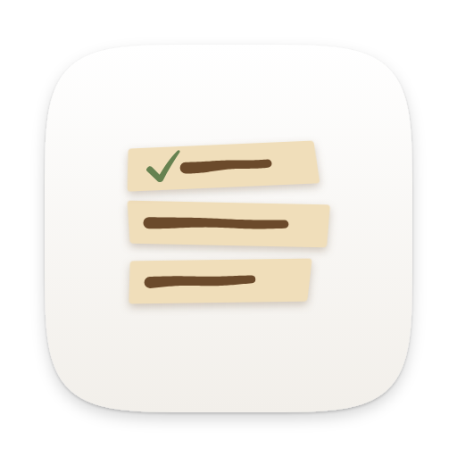

<h1 align="center">Dvarim</h1>

<b>My to-do app, where every to-do is a line in a Markdown file.</b> Delete the app tomorrow and your to-dos are still there, in Obsidian, as plain text.

  
  
  
  
  
  
  

  <a href="docs/README.md"><b>Docs</b></a> ·
  <a href="#install">Install</a> ·
  <a href="#features">Features</a> ·
  <a href="#screenshots">Screenshots</a> ·
  <a href="docs/how-i-use-it.md">How I use it</a>

<picture>
  <source media="(prefers-color-scheme: dark)" srcset="docs/images/hero-dark.png">
  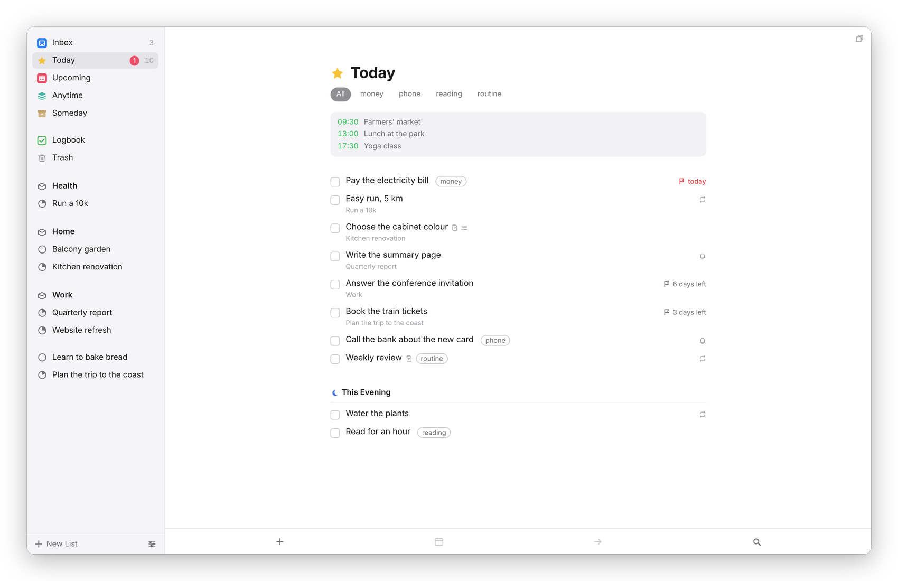
</picture>

## Why I built it

I know what I want from a to-do app: a Today list, This Evening, the difference between the day I'll start something and the day it's due, and never being asked a question when I'm only trying to get a thought out of my head. What bothered me about every one I tried was where the to-dos lived. Everything else I write lives in Obsidian, as Markdown files I own and that sync to every device I have, and my to-dos were the one thing locked inside somebody else's database.

So I built Dvarim (Hebrew דברים: "words", and also the matters on your plate). It has the Inbox, Today, Upcoming, Anytime, Someday and the Logbook, with areas, projects, headings, checklists, repeats and reminders, and underneath there's no database at all. An area is a folder, a project is a Markdown file, and a to-do is one line in it, in the same format the Obsidian Tasks plugin uses. Obsidian reads my to-dos like any other note, I can edit them there, and the app picks the change up a moment later.

Basically, instead of a to-do app with an export button, I have my to-dos as files, with a very good app on top of them.

## Features

### The way it works
- **The lists.** Inbox, Today with This Evening, Upcoming day by day, Anytime, Someday, the Logbook and the Trash, filled in by a few simple rules, so you never file a to-do into Today by hand. You give it a day, and on that day it's there.
- **When and Deadline are different.** "When" is the day you plan to start and "Deadline" is the day it has to be done, and the When popover reads dates the way you'd say them: "tom", "fri", "in 3 days", "wed 8pm".
- **Areas, projects and headings.** Projects with notes, a progress pie, headings you can archive, and a menu to complete, cancel, schedule or move them.
- **Headings in Today.** You can divide the day with headings of your own, like "Morning", "Calls" or "Errands", and drag the to-dos under them.
- **The to-do card.** Notes in Markdown with Obsidian's live preview, checklists you can paste a list into, nested tags, repeats on a schedule or after completion, and reminders.
- **The keyboard.** A shortcut for nearly everything, Quick Find on ⌘F or by just starting to type, and every key can be changed in Settings → Keyboard.

### Your files, ALWAYS
- **A folder of Markdown.** The files are the database. Sort order and settings, the only things that can't live in a note, sit in one small file beside them, and Settings → Data in a browser downloads the whole folder as a .zip.
- **The Obsidian Tasks format.** `⏳` for When, `📅` for the deadline, `🔁` for a repeat, `🆔` for each to-do's id, so the Tasks plugin and Dataview understand your to-dos too.
- **Edit the note itself.** Any project or area opens as its real Markdown file inside the app, and "Open in Obsidian" takes you to the right line in your vault.
- **Sync that doesn't lose things.** When two devices change the same file, Dvarim merges the two versions to-do by to-do, and a sync tool's conflict copy is merged back in and put away, never deleted.

### Every device
- **The web app.** Opens anywhere and installs as an app from the browser. It keeps a full copy of your to-dos on the device, so every list and every change works without a connection, even a list you haven't opened there yet, and it catches up with the server by itself when it's back.
- **The Mac app.** A native Mac app, every screen drawn by the Mac, with Quick Entry on ⌃Space from any app, Today in the menu bar, a Dock badge, notifications with a Complete button, the Services menu, and Shortcuts, Spotlight and Siri.
- **The Android app.** A Today widget you can tick off from, sharing into Dvarim from any app, reminders that arrive with the app closed, and a New To-Do tile.
- **With or without a server.** Both apps keep their own copy of your to-dos, synced with your server, so they open and work on a plane. They can also work straight on a folder on the device instead, kept in step by Syncthing, iCloud Drive, or the built-in WebDAV sync with a Dvarim server or Nextcloud.

### It plays with the rest of my server
- **Calendars.** Events from a CalDAV server like Radicale sit at the top of Today and under each day in Upcoming, and the apps can show the device's own calendars instead.
- **Tasks.org and other CalDAV apps.** If you turn it on, the server keeps your open to-dos in a CalDAV task list, both ways: tick one off in Tasks.org and it's ticked in the file.
- **Quick-add from anywhere.** One HTTP request with one line of text ("Call the plumber tomorrow 3pm #home !fri") adds a to-do, date and tag included, which is how my Signal bot does it.
- **Reminders over Signal**, from the server, for when you're only using the web app.
- **Other people, on your server.** Invite family and friends with a link, and each of them gets their OWN to-dos, in a folder of their own, on any phone or computer with a browser. Nobody sees anybody else's lists.

## Screenshots

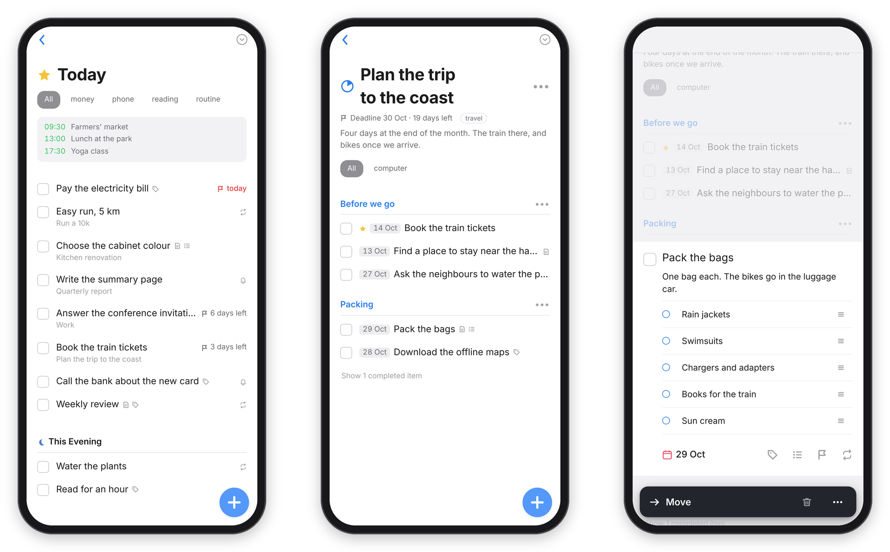

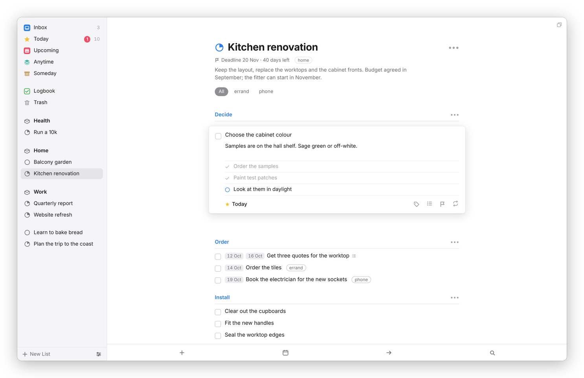
*A project with headings. The open to-do has notes and a checklist, and the pie fills as the project gets done.*

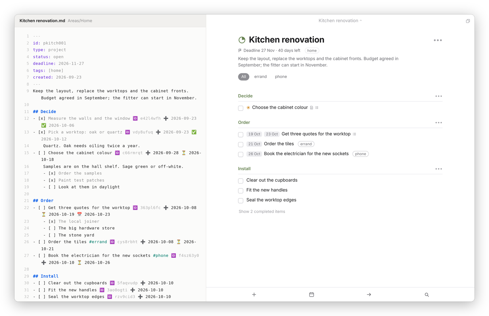
*The same project twice: the file on disk, and what Dvarim makes of it.*

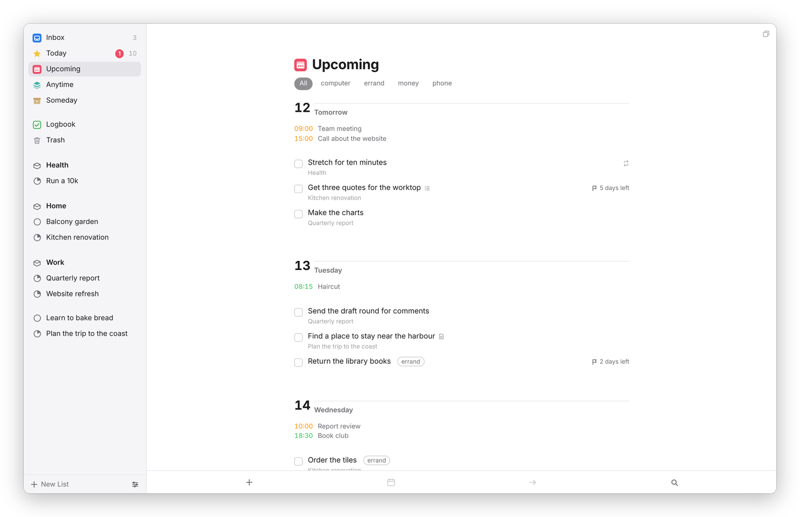
*Upcoming, day by day, with the calendar under each day.*

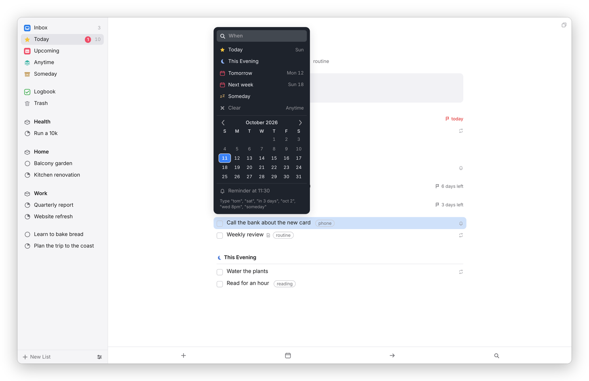
*The When popover. Pick, or type "tom", "sat" or "wed 8pm".*

More screenshots

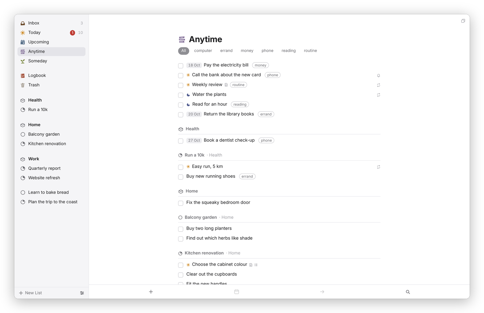
*Anytime: everything you could do now, loose to-dos first, then each area and project.*

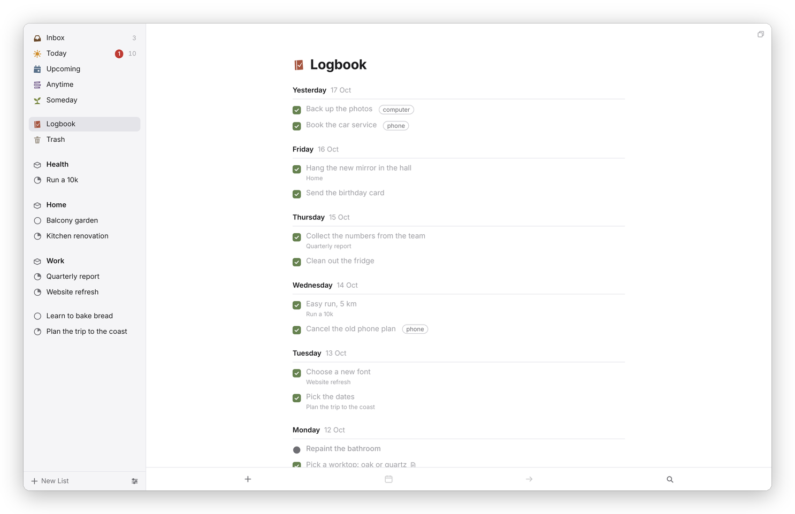
*The Logbook.*

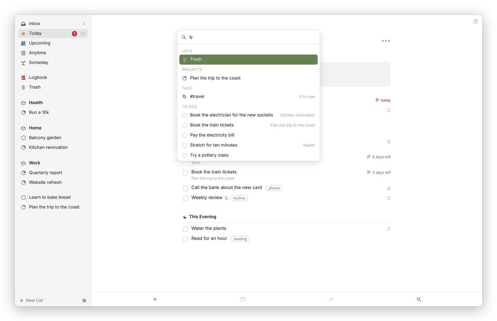
*Quick Find.*

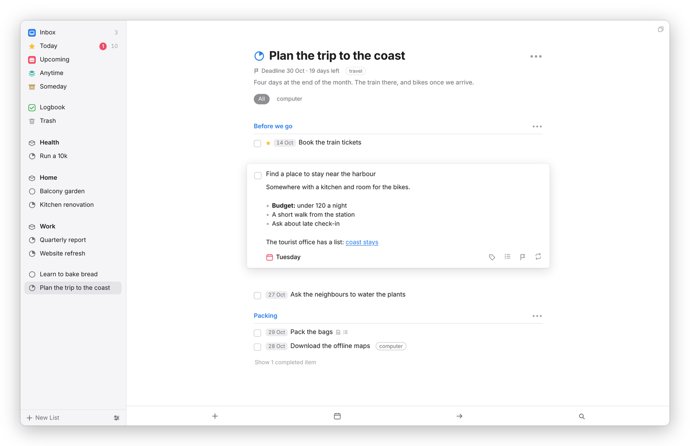
*Notes are Markdown, formatted as you read them.*

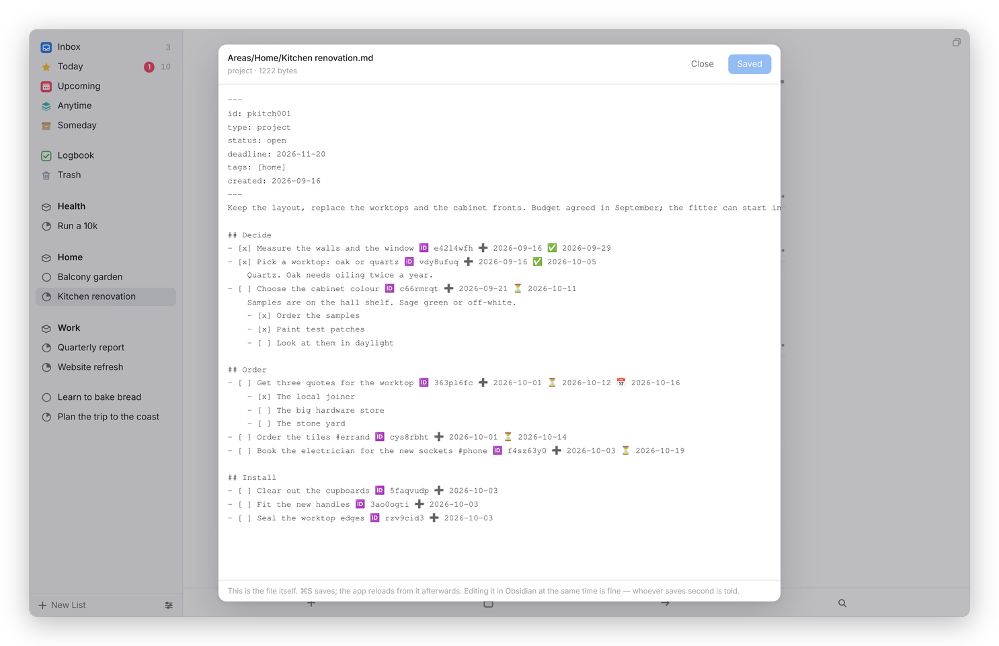
*Edit the note itself: the real file, inside the app.*

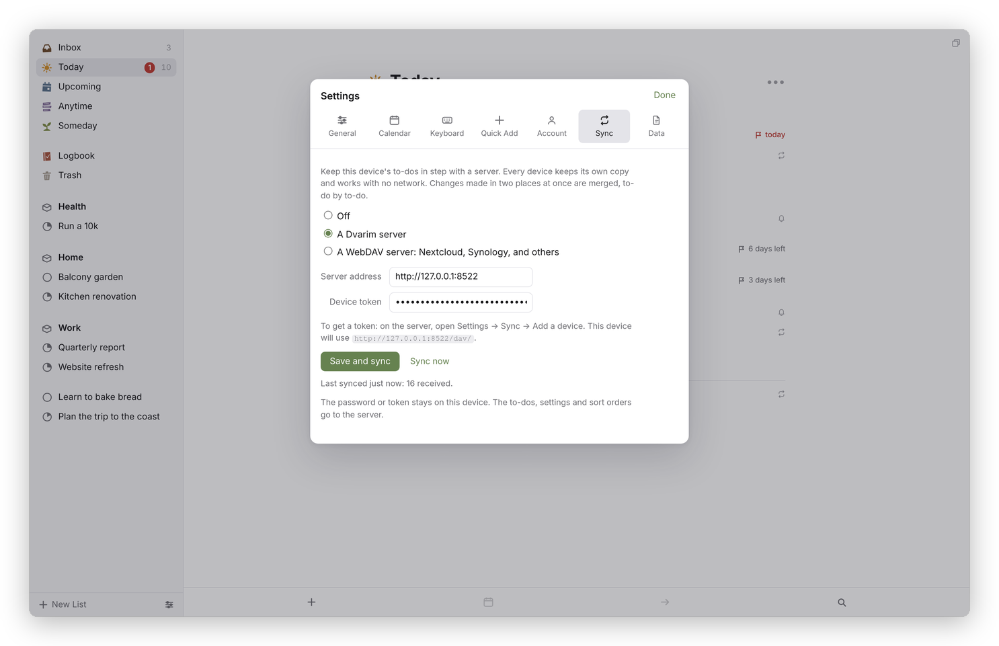
*The built-in sync, set up on a device.*

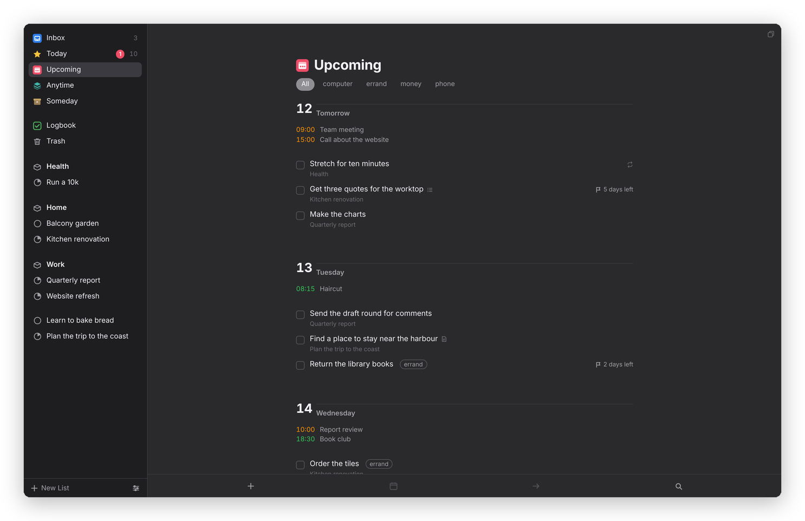
*Upcoming in dark mode.*

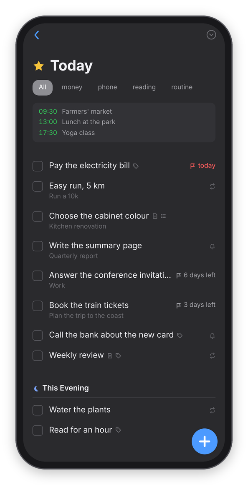 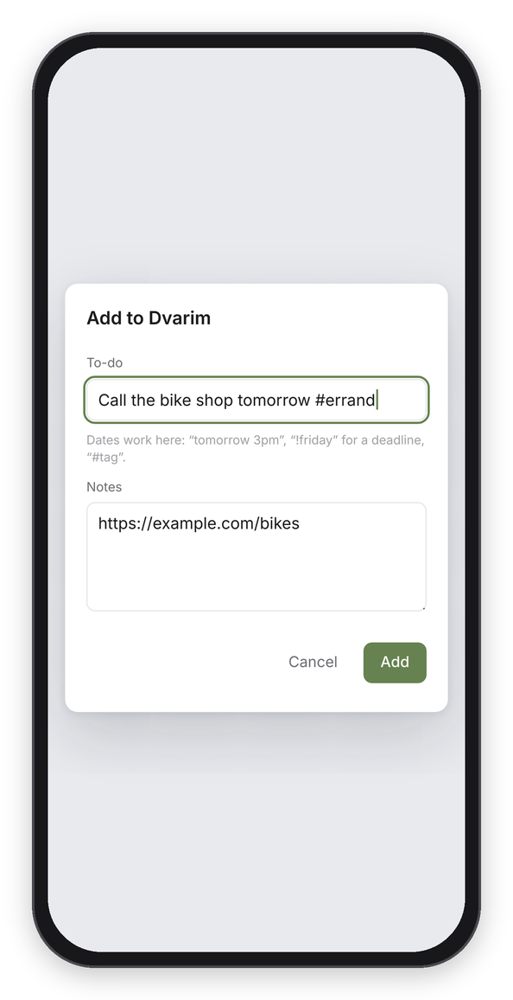 

*On the phone: Today in dark mode, a link shared in from another app, and the Repeat editor.*

## Install

### On the web
Run the server (below), open its address in any browser and sign in. To install it as an app, use the install icon in Chrome's address bar, **File → Add to Dock** in Safari, or **Add to Home screen** in Chrome on Android (that one needs HTTPS). The full steps are in [Install](docs/install.md).

### Mac
On macOS 26 or newer, install it with Homebrew: `brew install --cask franz-rosenzweig/tap/dvarim`, and `brew upgrade` follows each release. Or build it from this repository (the Command Line Tools, XcodeGen and Node): run `npm ci` in `frontend/`, then `mac/build-native.sh`, and copy `mac/build-native/Dvarim.app` to `/Applications`. See [Install](docs/install.md#3-the-mac-app) and [the Mac app](docs/mac.md).

### Android
The Android app is built from this repository too, with Google's Bubblewrap and a signing key of your own, and it needs your server on HTTPS. The steps are in [Install](docs/install.md#4-the-android-app), and what it does is in [the Android app](docs/android.md).

### Your own server
One Docker container and a folder: `docker build -t dvarim .`, run it with your to-dos folder mounted at `/data`, and set a password with `docker exec -it dvarim node server/src/cli.js set-password`. [Your own server](docs/server.md) has the full command, Docker Compose, HTTPS, calendars and reminders.

## Documentation

Everything about using Dvarim, your files, the apps and running a server is in the [docs](docs/README.md):

- **Getting started**: [What is Dvarim?](docs/what-is-dvarim.md), [How I use it](docs/how-i-use-it.md), [Install](docs/install.md)
- **Using Dvarim**: [the lists](docs/lists.md), [areas, projects and headings](docs/projects-and-areas.md), [to-dos](docs/todos.md), [dates and reminders](docs/dates.md), [repeats](docs/repeats.md), [quick entry and shortcuts](docs/quick-entry.md), [Quick Find](docs/search.md), [Settings](docs/settings.md)
- **Your files**: [the Markdown format](docs/files.md), [using it with Obsidian](docs/obsidian.md)
- **Devices & sync**: [Mac](docs/mac.md), [Android](docs/android.md), [sync](docs/syncing.md), [calendars](docs/calendars.md)
- **Running your own server**: [your own server](docs/server.md), [other people on your server](docs/PEOPLE.md)
- **Under the hood**: [developing](docs/DEVELOPING.md), [the file format](docs/FORMAT.md), [architecture](docs/ARCHITECTURE.md), [sync](docs/SYNC.md), [the API](docs/API.md), and the rest in the [docs index](docs/README.md#under-the-hood)

Start with [Getting started](docs/what-is-dvarim.md).

## How it's built

- **The files** are a folder of Markdown in the Obsidian Tasks format, plus `.dvarim/state.json` for sort orders and settings. There's no database and no index on disk: the app reads the folder into memory at startup, in well under a second for thousands of to-dos.
- **The engine** (`engine/`) is plain JavaScript with no dependencies: the format, the lists, dates, repeats and the per-to-do merge. The same code runs on the server, in the page, and in the Mac and Android apps.
- **The server** (`server/`) is Node with nothing to install, in one Docker container. It serves the web app, answers its requests from the folder, watches the folder for changes from Obsidian or a sync, offers the folder over WebDAV for the built-in sync, keeps a separate folder for each person you invite, and talks to CalDAV and Signal.
- **The web app** (`frontend/`) is Svelte 5, built with Vite. It keeps a full copy of your to-dos in the browser and runs the engine on it, synced with the server over that same WebDAV, so it works offline.
- **The native apps** keep the to-dos in a folder of the app's own by default, synced with the server. On the Mac (`mac/`) every screen is SwiftUI and AppKit, with the engine running inside the app in JavaScriptCore. Android (`android/`) is a shell around the same web app, which it carries inside it, in Android's own WebView, or a Trusted Web Activity when it opens the server.

## Privacy

Dvarim doesn't phone home. There's no tracking, no account with me and nothing sent anywhere in the background. Your to-dos stay on your device unless you turn on a sync option, with your own Dvarim server or a WebDAV server like Nextcloud, and then they go only to the server you chose. The server, in turn, only talks to the calendar server and the Signal sender you give it, if you give it any. One thing to know: for now the Mac and Android apps come set to my server's address, so put in your own before you sign in.

## License

Dvarim is free software: you can use it, change it and share it under the GNU General Public License, version 3 or (at your option) any later version. See [LICENSE](LICENSE).

## Credits

- [Obsidian Tasks](https://github.com/obsidian-tasks-group/obsidian-tasks) (MIT), whose emoji format is the base of Dvarim's file format.
- [Svelte](https://svelte.dev) (MIT) and [Vite](https://vitejs.dev) (MIT), with `@sveltejs/vite-plugin-svelte` (MIT), for the web app.
- [CodeMirror 6](https://codemirror.net) and [Lezer](https://lezer.codemirror.net) (MIT), for the Markdown notes editor.
- [Node.js](https://nodejs.org) (MIT), on which the engine and the server run with no other packages.
- [Bubblewrap](https://github.com/GoogleChromeLabs/bubblewrap) and [android-browser-helper](https://github.com/GoogleChrome/android-browser-helper) (Apache 2.0), and [OkHttp](https://square.github.io/okhttp/) (Apache 2.0), for the Android app.
- [XcodeGen](https://github.com/yonaskolb/XcodeGen) (MIT), which turns `mac/project.yml` into the Mac app's project.
