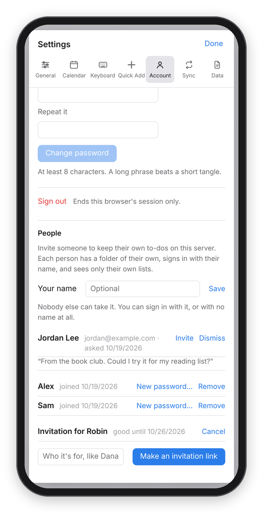

[Dvarim docs](README.md) › Running your own server

# Other people on your server

Dvarim started as just mine, but it doesn't have to stay that way. If you run
the server, you can invite family and friends to keep their OWN to-dos on it,
which means they get the whole app without running anything themselves. They
just open a link.

## Inviting someone

Go to Settings → Account, and under People choose "Make an invitation link".
You can write who it's for, which also fills in their name when they open it.
Send them the link however you like. It works once, for a week, and Dvarim
shows it only at that moment, so copy it before you close Settings. If you
change your mind before they use it, Cancel takes it back.

*People, under Settings → Account: a request waiting for an answer, two people, and an invitation nobody has used yet.*

When they open the link, they pick a name and a password, and they're in.
From then on they sign in with that name and password, on any device. Their
list starts with a project called "Meet Dvarim", which is a short tour where
every to-do is something to try.

## When someone asks first

People who don't have an account yet can ask for one. Under the sign-in box
there's a "No account? Ask for one" link, where they leave their name, their
email and a line about themselves. The next time you open Dvarim, it tells you
someone asked, and their request is waiting under People with what they wrote.

Choose Invite, and Dvarim makes an invitation in their name and gives you an
"Email it" button, which opens your mail app with a short note and the link
already in it, so you can read it over, change what you like and send it.
Choose Dismiss if you'd rather not, and they aren't told either way.

Bots find forms like this, so it's careful: anything that fills in a field
people never see is quietly ignored, one address can only ask a few times a
day, and no more than 30 requests are kept waiting at once. If you'd like a
Signal message when someone asks, set up the same `DVARIM_SIGNAL_*` settings
that reminders use, and it'll send one.

## Naming yourself

You can also give yourself a name under People. Nobody else can take it, and
you can sign in with it or with no name at all, the way you always have.

## What they get, and what they don't

Each person has a folder of their own on the server, and sees only their own
lists. They can't see yours, you can't see theirs in the app, and they can't
see each other's. They can change their own password, add their own devices
in Settings → Sync, and download all their to-dos as a .zip from
Settings → Data, so nothing is ever stuck in here.

The things that are wired to your own accounts stay yours: the calendars from
your Radicale server, the Tasks.org mirror, and reminders over Signal. For
everyone else those are simply not set up.

Basically, it's the same Dvarim, with a separate set of files for each person.

## Phones, iPhones and Windows

Nobody needs a special app. On an iPhone or iPad, open the site in Safari, then
Share → Add to Home Screen. On Android, the Dvarim app works, or Chrome's
"Install app". On Windows, Edge or Chrome can install it from the address bar.
On a Mac, Safari's File → Add to Dock does the same. Each of those opens like
an app and signs in once for 30 days.

## Being honest about where it lives

Their files are kept on your server, in a `people` folder beside your password
file (`people/<name>/`, next to `auth.json`), outside your to-dos folder, so
they never reach your devices or your Obsidian vault. Back that folder up along
with the rest. On my server it's `/srv/docker/dvarim/people/`, and it goes into
the nightly backup with everything else in `/srv/docker`. The app keeps everyone
apart, but as the person who runs the server you COULD read the files, so
it's only fair to tell people that when you invite them.

## When something goes wrong

If someone forgets their password, choose "New password…" next to their name,
set one, and pass it on to them. That signs them out everywhere until they use
it.

If someone shouldn't use the server anymore, choose Remove. They're signed out
at once, and their folder is moved to `people/.removed/`, never deleted, so if
it was a mistake their to-dos are all still there.

The settings behind this are in `auth.json`, next to your own password, and
the requests in `requests.json` beside it. People need two things from the
server: a password, and a password file outside the to-dos folder, which the
commands in [Your own server](server.md) already give you. To keep the people
somewhere else, set `DVARIM_PEOPLE` to a folder outside your to-dos folder.
Dvarim refuses one inside it, because then their to-dos would land on your
devices, and Settings → Account says so instead of offering invitations.

Next: [Developing Dvarim](DEVELOPING.md) →
