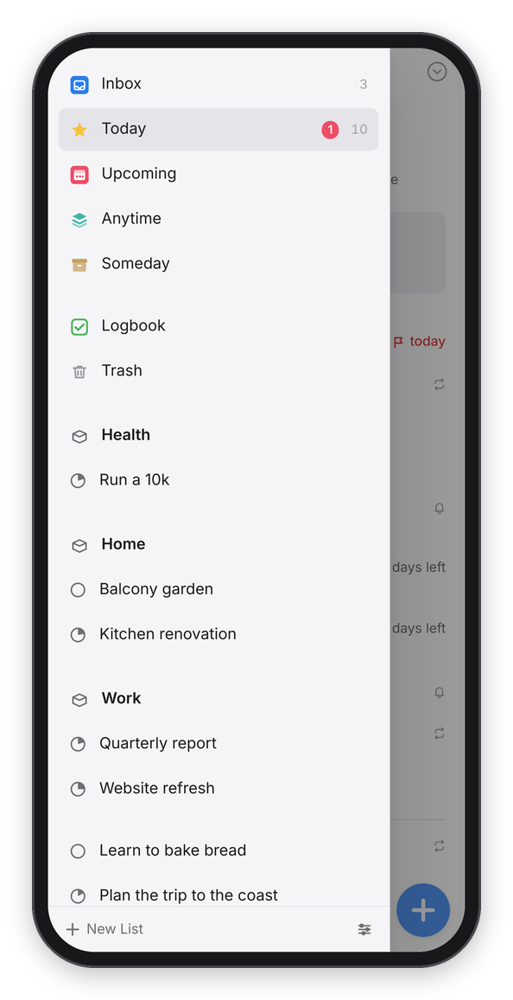

[Dvarim docs](README.md) › Devices & sync

# The Android app

The Android app is Dvarim on the phone as a real app, with its own icon, its own window and its own notifications, plus the things a browser tab can't do: a Today widget on the home screen, sharing into Dvarim from any app, reminders that arrive with the app closed, and a New To-Do tile. Inside, it's the same web app as everywhere else, laid out for a thumb. To build and install it, see [Install](install.md#4-the-android-app).

  

*Today on the phone, the lists drawer, and a link shared in from another app.*

## Getting around

The lists live in a drawer: tap the arrow at the top left, or drag in slowly from the left edge of the screen. A quick flick from the edge is still Back, the way it is everywhere on Android. Pull a list down from the top to open Quick Find. The app follows the phone into light or dark mode, unless you chose otherwise in Settings → General.

These are the gestures:

- **Tap** a to-do to open it, and the dark bar under it has **Move**, the bin, and ••• for the rest.
- **Swipe a little to the right** and let go, and the When popover opens.
- **Swipe a little to the left** to start choosing several, then tap the others. The bar at the bottom has **When**, **Move**, **Tags** and **Delete**.
- **Hold** a to-do to pick it up and drag it somewhere else in the list.
- **The green plus** makes a to-do. Hold it and carry it to put the new to-do exactly where you let go, or to the Inbox target at the bottom left, or, in a project, to the left margin to make a heading.

## On a tablet

It's the same app on a tablet, and it lays itself out for the screen. Held upright, a tablet gets the phone's layout, just roomier, with tags written out. Turned on its side, it gets two panes: the lists stay on the left the whole time, the to-dos have room on the right, and a to-do opens in place in the list. The gestures above all work there too, the green plus sits in the corner of the list, and Quick Find is the magnifier at the top right.

The S Pen works like a fine pointer. Tap a to-do with it to open it, press on a to-do and move to pick it up straight away without holding, and press the pen's side button as you tap a to-do for its menu: When, Move, Tags, Deadline, Repeat and the rest. While the pen is over the screen, your hand can rest on it: a finger or a palm touching the glass doesn't tap or scroll anything until the pen has moved away.

With a keyboard cover or a mouse, or in DeX, the app switches to the desktop layout and every keyboard shortcut works, with Ctrl where a Mac has ⌘.

## The Today widget

Long-press the home screen, add the Dvarim widget, and it lists today's to-dos. The box beside each one completes it right there, even on a plane: the tick is kept on the phone and sent when there's a connection again. Tapping the rest of a row opens that to-do in the app. Android only refreshes a widget every half hour, so the arrow in its corner refreshes it now, and so does completing something or opening the app.

## Sharing into Dvarim

Share a link, a page or some text from any app and choose Dvarim. A sheet called **Add to Dvarim** opens with the title filled in and the link in the notes. Fix the wording, add a date the quick-entry way ("tomorrow 3pm", "!friday" for a deadline, "#tag"), and press **Add**. If the server can't be reached, the line waits on the phone and is added when it's back.

## New To-Do

Long-press the app's icon for **New To-Do**, **Today**, **Inbox** and **Settings**. New To-Do opens the Inbox with an empty to-do ready to type, and you can put it in the quick-settings shade too, from the pencil at the bottom of the shade.

## Reminders

A to-do's reminder arrives as an Android notification even when the app is closed, with a **Complete** button, and tapping it opens the to-do. Android asks about notifications the first time the app opens. For reminders on the minute rather than within a few minutes, Android 12 and later also want **Alarms & reminders** allowed for the app, and the app's settings take you there. A reminder missed while the phone was off still arrives once it's on, up to six hours late. If the server also sends reminders over Signal, turn one of them off.

## The app's own settings

A few things belong to the app rather than the server, so they live on a screen of its own: long-press the icon and choose **Settings**, or use the link at the bottom of the web app's Settings → Data.

- **Server**: the address the app opens, with **Test** and **Save**. It has to be an https address, and **Use the built-in address** goes back to the one the app was built for.
- **Where your to-dos live**: **On this phone, synced with the server** (the default, see below), **On the server only**, or **In a folder on this phone** with **Choose…**.
- **Notifications**: **Remind me on this phone**, whether Android is letting them through, links to Android's own settings for notifications and for **Alarms & reminders**, and **Send a test reminder**.
- **About**: the version, the address in use, and **Clear cached pages**.

## Your to-dos on the phone

With **On this phone, synced with the server**, the app keeps a copy of your to-dos in a folder of its own on the phone and syncs it with the server a moment after each change, when you come back to the app, and every few minutes. The first time it opens, sign in on the server's own sign-in page, inside the app, and it sets itself up: it adds the phone to the server's devices (you'll see it, named after the phone, in the web app's Settings → Sync) and keeps the copy from then on. The app opens and works with no network, and the widget, the New To-Do tile and reminders all read the copy. **Sign out** in Settings → Account sends what's left, takes the phone off the server's list, and deletes the copy.

## A folder instead of a server

With **In a folder on this phone**, Android's folder picker asks which folder to use, for example the Tasks folder of a vault that Syncthing keeps on the phone. The app then reads and writes that folder itself, with no server, and looks for changes every 15 seconds while it's in front. The widget and reminders work from what the folder held when the app was last open. If nothing else syncs the folder, the web app's Settings → Sync can keep it in step with a Dvarim server or another WebDAV server (see [Sync](syncing.md)), and Settings → Calendar can show the phone's own calendars (see [Calendars](calendars.md)).

## Without a connection

With the copy, the whole app works on the phone, and what you do reaches the server when it's back. On the server only, the app keeps every list as it last saw it and says how old it is, and whatever you do meanwhile waits on the phone and is sent, in order, when the server answers again. The widget can't read while it's offline, so it says it can't reach the server rather than showing an empty day.

The build notes, the signing key, and what to do when Bubblewrap misbehaves are in [the Android build notes](https://github.com/franz-rosenzweig/dvarim/blob/master/android/README.md).

Next: [The Windows app](windows.md) →
