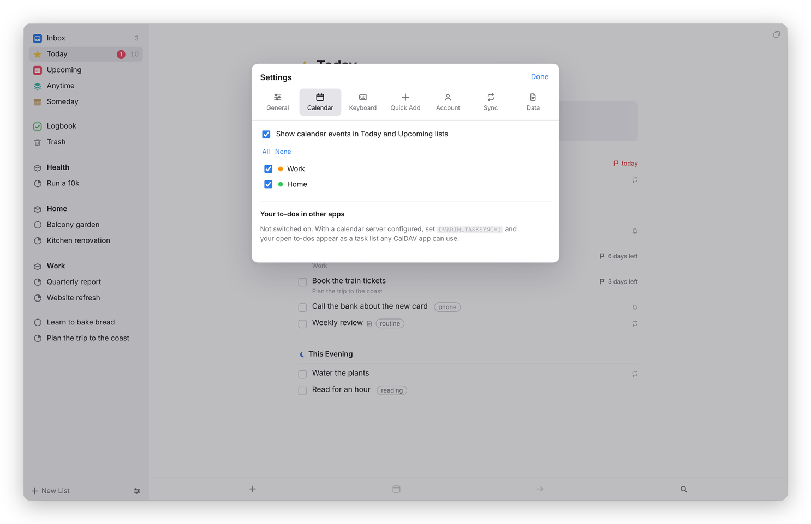

<sub>[Dvarim docs](README.md) › Devices & sync</sub>

# Calendars

This page covers two things: your calendar's events showing up in Today and Upcoming, and your to-dos showing up in other apps through a CalDAV task list. Both are off until you set them up, and the first never writes anything to your calendars.

## Events in Today and Upcoming

Appointments aren't to-dos, but you want to see them next to the day's to-dos. With calendars set up, Today shows the day's events in a grey block at the top, each with its time in the calendar's colour, and Upcoming shows each day's events under that day's heading. Repeating events, moved and canceled occurrences, and all-day events that cover several days all show the way your calendar app shows them.

The events can come from two places.

**From your server.** I keep my calendars on my own Radicale server, and Dvarim's server reads them over CalDAV. Give it three settings, the address of your calendars (the collection that holds them, like `http://radicale:5232/yourname/`), a user name and a password:

```yaml
DVARIM_CALDAV_URL: http://radicale:5232/yourname/
DVARIM_CALDAV_USER: yourname
DVARIM_CALDAV_PASS: your-password
```

It only ever reads them, and it asks again at most once a minute. [Your own server](server.md) shows where these go.

**From the device.** When the Mac or Android app works on a folder instead of a server, it can show the device's own calendars, the ones in the Mac's Calendar app or on the phone. Nothing is asked for until you turn it on: on the Mac, **Use this Mac's calendars** in Settings… → Dvarim; on Android, **Show this device's calendars** in Settings → Calendar. The device asks you for permission once. If you said no and change your mind, it's in System Settings → Privacy & Security → Calendars on the Mac, and Settings → Apps → Dvarim → Permissions on Android.

## Choosing which calendars


*Settings → Calendar.*

In Settings → **Calendar**, **Show calendar events in Today and Upcoming lists** turns the whole thing on or off without forgetting your choices. Under it is every calendar with its colour and a checkbox. **All** and **None** tick or untick them together, and unticking them all really does mean none.

## Your to-dos in other apps

The server can also keep a copy of your open to-dos in a task list on your CalDAV server, called **Dvarim**, so that Tasks.org on Android, Apple Reminders or any other CalDAV app can show them. It goes both ways. Tick one off there and it's ticked in the Markdown file; change its title, dates or tags and those come back too; make a new one there and it lands in your Inbox; delete one and Dvarim moves it to the Trash, where you can still get it back.

It's off unless you turn it on, because it writes to your calendar server:

```yaml
DVARIM_TASKSYNC: "1"           # turn the mirror on
DVARIM_TASKSYNC_EVERY: "300"   # seconds between rounds
DVARIM_TASKSYNC_SOMEDAY: "0"   # "1" sends Someday to-dos too
```

Every open to-do that isn't in Someday goes over, and a completed one is taken off the list, because that list is meant to be the work in front of you. Settings → Calendar, under "Your to-dos in other apps", says when it last ran and has a **Sync now** button.

A task in a CalDAV app can't say everything a Dvarim to-do can. There's no This Evening, no Someday, no headings and no checklists, and most apps don't tell a start date from a deadline. So Dvarim keeps those in fields of its own that other apps carry along without showing, and it only believes an app about the fields that app can actually express. If Tasks.org rewrites a task without Dvarim's fields, that's read as "no opinion", not as "cleared", so a round trip changes the title you changed and leaves the headings, checklist and This Evening exactly as they were. Dates are the exception: an app that drops a date means you cleared it.

To see the list in Tasks.org, add a CalDAV account pointing at your server, tick **Dvarim** among the lists it finds, and it appears as a list. A tick there reaches the Markdown file on the next round, within five minutes, or straight away if you press **Sync now**.

The details, including exactly what's sent, are in [Integrations](INTEGRATIONS.md).

<sub>Next: [Your own server](server.md) →</sub>
