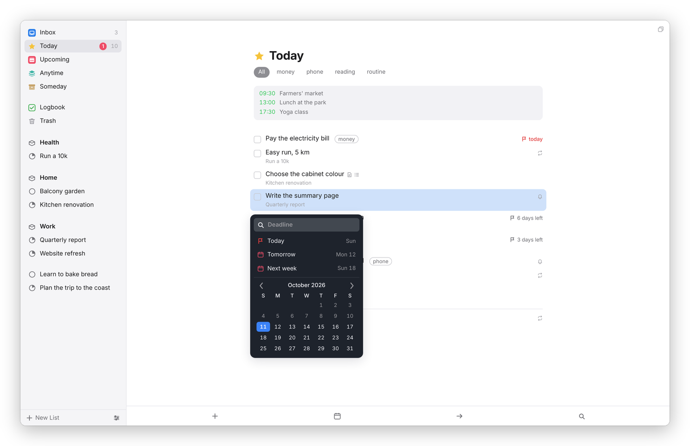

[Dvarim docs](README.md) › Using Dvarim

# When, deadlines and reminders

A to-do in Dvarim can have two dates, and they mean different things, which is the most useful idea in the whole app. "When" is the day you plan to start: on that day the to-do shows up in Today, and until then it waits in Upcoming. "Deadline" is the day it has to be finished. A to-do can have one, both or neither, and a reminder is a time on its When day.

## When

Select a to-do and press ⌘S, or click the calendar that appears beside a row when you point at it, or the date at the bottom of an open card. The When popover opens:

*The When popover. Type in it, or pick.*

- **Today** puts it in Today, and **This Evening** in the evening part of Today.
- **Tomorrow** and **Next week** are what they say. Next week means the first day of next week, which follows **Week starts on** in Settings → General.
- **Someday** parks it in Someday, with no date.
- **Clear** takes the date away, which puts it back in Anytime.
- Any day on the calendar sets that day, and the arrows move between months.

You can also just type. The field at the top reads dates the way you'd say them: "tom", "sat", "in 3 days", "next week", "oct 2", "9 jul", "2w", "tonight", "someday", and with a time, "wed 8pm" or "tomorrow 15:00", which sets the day and a reminder together. The suggestions show the actual date beside each one, so you can see what it understood, and Return takes the highlighted one. If it can't find a date in what you typed, it says so.

The keys skip the popover altogether: ⌘T for Today, ⌘E for This Evening, ⌘R for Anytime (no date), and ⌘O for Someday. On a phone, swipe a to-do a little to the right and let go, and the When popover opens.

A When date in the past still counts as Today. Nothing slips off the list because a day went by: it stays in Today until you do it or give it another day.

## Deadline

Press ⇧⌘D, or the flag at the bottom of an open card, and pick a day the same way, by typing or from the calendar.

*The Deadline popover, on a to-do in Today.*

A to-do with a deadline shows a flag and how many days are left, and on the day itself, or once it's past, it comes into Today even if its When is later, with the flag in red. In the sidebar, the red number beside Today counts the deadlines due today. A to-do with a deadline and no When stays in Anytime until then, and shows in Upcoming on its deadline day.

## Reminders

A reminder is a time on the to-do's When day. In the When popover, click **Add Reminder**, choose a time and click **Set**, or type a time with the date, like "fri 9am". The card then says "Reminder at 09:00", and a small bell shows on the row. **Remove Reminder** in the same popover takes it off.

Where the reminder reaches you depends on what you use:

- **The Mac app** shows a notification, with a **Complete** button, and clicking it opens the to-do. It's on unless you turn off **Remind me on this Mac** in Dvarim → Settings… → This Mac.
- **The Android app** does the same, even with the app closed, and **Remind me on this phone** in its settings turns it off.
- **The server** can send each reminder as a Signal message, if it has a Signal sender set up (see [Your own server](server.md)).

A browser on its own doesn't notify, so if you use only the web app, the Signal route is the one to set up. And if both Signal and an app are on, you'll hear about the same to-do twice, so pick one.

Reminder times are the time where you are, on the to-do's own day.

## In the file

Each date is a marker on the to-do's line: `⏳` before the When date, `📅` before the deadline, `⏰` before a reminder time, `🌙` for This Evening and `💤` for Someday. The first two are the Obsidian Tasks plugin's own "scheduled" and "due", so Obsidian reads them too. [Your to-dos as Markdown](files.md) has an example.

Next: [Repeating to-dos](repeats.md) →
