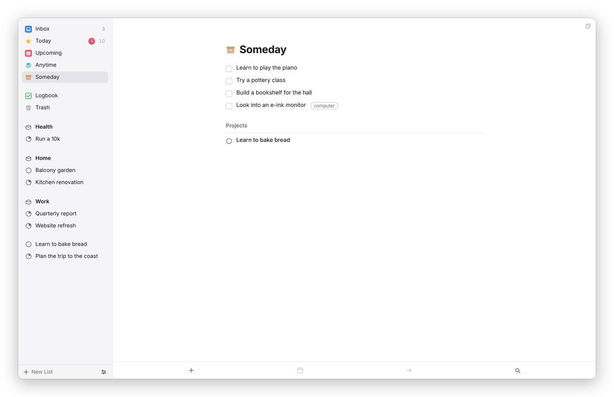

[Dvarim docs](README.md) › Using Dvarim

# The lists

The lists at the top of the sidebar are how Dvarim decides what to show you and when. Every open to-do is in exactly one of Inbox, Anytime or Someday, and the date it has decides whether it also shows in Today or Upcoming. You never file a to-do into Today by hand. You give it a day, and on that day it's there.

## Inbox

The "Inbox" is where things land before you've decided anything about them. A to-do you make in the Inbox, a quick-add line with no date in it, and anything the Signal bot or a Shortcut sends without a date all go here. The idea is that getting a thought down should take one line and no decisions, and the deciding happens later, when you go through the Inbox and give each thing a project, a day, or both. The number beside it in the sidebar is how many are waiting.

Once a to-do has a project or a date, it leaves the Inbox.

## Today and This Evening

"Today" is everything you mean to do today. A to-do is in Today when its When is today or earlier, or when its deadline is today or has passed, and a project whose When is today is listed at the top with its progress pie. If you've set up calendars, the day's events sit at the top.

*Today. The grey number in the sidebar counts the list, and the red one counts deadlines due today.*

"This Evening" is the part of Today you can only do later, and it sits at the bottom with a moon. Press ⌘E on a selected to-do, or choose **This Evening** in the When popover, to put it there.

The order of Today is yours. Drag a to-do up or down, or press ⌘↑ and ⌘↓, and it stays where you put it. If you'd rather have Today grouped, turn on **Group to-dos in the Today list by project or area** in Settings → General, and the loose to-dos come first, then a heading for each project and area in sidebar order.

You can also divide Today with headings of your own, such as "Morning", "Calls" or "Errands". Choose **New Heading** from the ••• next to Today's title, press ⌘⇧N, or on a phone let go of the + button at the left edge of the list. Drag to-dos under a heading, or back above the headings, and they stay there; a to-do new to Today starts above them. A heading's ••• renames it, moves it up or down, adds a to-do under it, or deletes it, and its to-dos stay in Today (Undo brings it back). These headings live in `.dvarim/state.json`, not in any note, because Today isn't a note. They stay from one day to the next, and a to-do keeps its heading if it leaves Today and comes back. With **Group to-dos in the Today list by project or area** on as well, the to-dos above your headings are the ones grouped.

One small thing I added: when the same project has more than one to-do in Today, a quiet line at the end of the list says so, like "More than one to-do from Kitchen renovation (2)", with the project's name as a link. Today works best as one next step per project. A project whose name has "agenda" or "admin" in it is left out, because that's where errands pile up on purpose.

## Upcoming

"Upcoming" is the days ahead. The next seven days each get their own heading, starting with tomorrow, and further out the days are grouped by month. Under each day are its calendar events, the to-dos whose When is that day (a repeating to-do shows on the day of its next copy), the to-dos whose deadline is that day if they have no When, and any project that starts or is due that day. It looks a year ahead.

*Upcoming, day by day, with the calendar under each day.*

To move a to-do to another day, drag it onto that day's heading. Within a day, you can drag the to-dos into the order you want.

## Anytime

"Anytime" is every open to-do you could do now: everything that isn't in the Inbox, isn't parked in Someday, and isn't waiting for a later day. Loose to-dos come first, then a group for each area and project in sidebar order. Anything that's also in Today shows a yellow star, and This Evening a moon, so you can see at a glance what's already planned.

*Anytime is the pool to draw from.*

## Someday

"Someday" is for things you might do but haven't committed to. A to-do in Someday stays out of Anytime, Today and Upcoming until you take it out again. The list shows the Someday to-dos first and then the projects you've put in Someday. ⌘O sends a selected to-do here, and so does **Someday** in the When popover.

*Someday, with its projects listed after the to-dos.*

## Logbook

The "Logbook" is everything you've completed or canceled, newest first, grouped by the day you finished it. **Show earlier** at the bottom goes further back.

*The Logbook, newest first. A finished project is listed on the day it was done.*

When a completed to-do moves to the Logbook is up to you, in Settings → General → **Move completed items to Logbook**: **Immediately**, **Daily** (it stays in its list, ticked, until the day turns) or **Manually**. With Daily or Manually, the Logbook tells you how many completed items are still in their lists and has a **Log Now** button, and ⇧⌘Y does the same from anywhere.

## Trash

The "Trash" is where deleted to-dos and projects go, and they stay there until you empty it. **Restore** puts one back where it came from, and **Empty Trash** deletes everything in it for good. In the files, a deleted to-do moves to `Trash.md` and a deleted project's file moves into the `Trash` folder, so even then nothing is gone until you empty it.

## Filtering by tag

Today, Upcoming, Anytime and every project have a row of tags under the title when any of their to-dos are tagged. Click a tag to see only the to-dos that have it, and **All** to see everything again.

## On the phone

On a phone the lists live in a drawer: tap the back arrow at the top left, or swipe in slowly from the left edge. Pull any list down from the top to open Quick Find.

Next: [Areas, projects and headings](projects-and-areas.md) →
