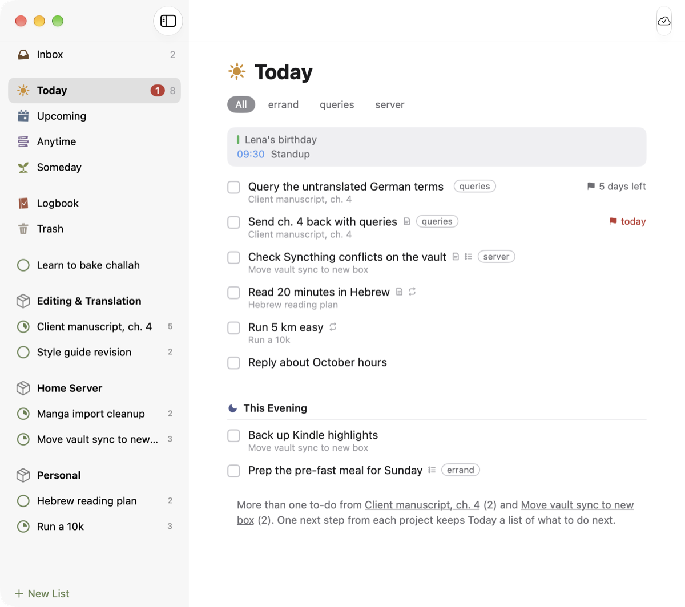

[Dvarim docs](README.md) › Devices & sync

# The Mac app

The Mac app is Dvarim made the way a Mac app is made: every screen is drawn by the Mac itself, in SwiftUI, and Dvarim's own engine runs inside it, the same one the server and the web app run. So every list works the same as in the browser. Beside the window it has what only a Mac app can do: Quick Entry from any app, Today in the menu bar, a badge on the Dock, notifications, and Shortcuts. To build and install it, see [Install](install.md#3-the-mac-app).

*Today in the Mac app, with the day's calendar events above the to-dos.*

## Quick Entry

Press ⌃Space in any app and a small panel opens over what you're doing, with a line for the to-do and room for notes under it. Type it the way you'd say it, "Call the bank tomorrow 11am #phone !fri", press Return, and it's saved to the Inbox, or to Today or Upcoming if you gave it a date. The panel closes and you're back where you were, without Dvarim ever coming to the front. Escape closes it without saving.

You can choose another key in **Dvarim → Settings… → This Mac**: click the shortcut and press the one you want. It has to use ⌃, ⌥ or ⌘. macOS itself uses ⌃Space to switch keyboard languages, and Settings says so when your choice clashes with one of its own; turn that one off in System Settings → Keyboard → Keyboard Shortcuts → Input Sources, or pick another. **File → Quick Entry** always works.

## The window

The sidebar has Inbox, Today, Upcoming, Anytime, Someday, Logbook and Trash, then your areas and projects; ⌘1 to ⌘7 go to the lists. Double-click a to-do to open it in place, with its notes, checklist and tags. The **Items** menu, and a right-click on a row, hold everything you can do to the chosen to-dos, each with its key: Complete ⌘K, When ⌘S, Today ⌘T, This Evening ⌘E, Deadline ⇧⌘D, Tags ⇧⌘T, Move ⇧⌘M, Repeat ⇧⌘R and more. The When picker reads what you type ("tom", "sat", "in 3 days", "wed 8pm"). Every change undoes with ⌘Z and comes back with ⇧⌘Z.

Drag to-dos to put them in order, onto a day in Upcoming, into This Evening, or onto a list, project or area in the sidebar. ⌘F is Quick Find. ⌃⌘N opens another window, and **Open in New Window** on a list in the sidebar opens one there. Today, Anytime, Upcoming and projects have their to-dos' tags under the title, to show only the ones with a tag.

## Today in the menu bar and on the Dock

With **Show Today in the menu bar** on (Settings → This Mac), today's count sits beside the clock, and clicking it shows the list, where you can tick a to-do off without opening a window. The Dock icon shows a badge too, counting Today, the Inbox, or nothing, as **Dock badge** in Settings → This Mac says; the web app's Settings → General → **Badge count** is the same setting.

## Reminders

A to-do's reminder arrives as a Mac notification, with a **Complete** button, and clicking the notification opens that to-do. **Remind me on this Mac** in Settings → This Mac turns this off, for instance if the server already sends you reminders over Signal. The app has to live in `/Applications` for macOS to let it ask for notifications at all, and if you once said no, you turn it back on in System Settings → Notifications → Dvarim.

## From other apps

Select some text in any app and choose **New To-Do in Dvarim** from the app's Services menu: Quick Entry opens with the first line as the title and the rest as notes. You can give it a key of its own in System Settings → Keyboard → Keyboard Shortcuts → Services.

Shortcuts, Spotlight and Siri know three actions: **Create To-Do** (with a list to put it in, the Inbox unless you say otherwise), **Show Quick Entry** and **Open List**. These need the app to be built on a Mac with Xcode installed, and launched once, before Shortcuts lists them.

## Where your to-dos live

**Settings… → Where** has three choices, and the first is the default:

- **On this Mac, synced with the server.** The app keeps a copy of your to-dos on the Mac, in a folder of its own, and syncs it with the server a moment after each change, when the window comes to the front, and every few minutes. Sign in once and it sets itself up: it adds this Mac to the server's devices (you'll see it, named after the Mac, in the web app's Settings → Sync) and keeps that device's token in the Keychain. From then on it opens with no network. **Sign out** sends what's left, takes the Mac off the server's list, and moves the copy to the Trash.
- **On the server only.** Every list is asked of the server as you open it.
- **In a folder on this Mac.** A folder you choose, with no server at all (below).

## Without a connection

With the copy, there's nothing to wait for: the whole app works on the Mac, and what you do reaches the server when it's back. Calendar events for the next six weeks are kept on the Mac too. On the server only, a Quick Entry line, a Create To-Do from Shortcuts, a tick in the menu bar and a reminder's **Complete** are kept on the Mac and sent when the server answers again. Quick Entry says how many are waiting, and the badge and the menu bar keep showing what they last knew.

## A folder instead of a server

In **Settings… → Where**, choose **In a folder on this Mac** and pick a folder, like the Tasks folder of your Obsidian vault. The app then reads and writes that folder itself, with no server at all, and when Obsidian, Syncthing or iCloud Drive changes a file, it's on screen a moment later. The menu bar, the badge, Quick Entry and reminders all work on the folder too. **Use this Mac's calendars** in Settings → Dvarim shows your Mac's own calendars in Today and Upcoming (see [Calendars](calendars.md)); macOS asks first.

## Dvarim's own settings

**Settings… → Dvarim** holds the settings that belong to your to-dos rather than to this Mac, so they're the same on every device: when completed to-dos move to the Logbook, the week's first day, grouping Today by project or area, showing calendar events and from which calendars, and the tutorial again. The web app's Settings changes the same ones.

## Signing in

The server's address is in **Settings… → Where**. On a server with a password, the Dvarim window asks for it once. It goes to the server and nowhere else, and the app doesn't keep it. With the copy, the app turns that sign-in into a device token of its own, which is what it syncs with from then on.

The build notes, signing, and the self-test that drives the built app are in [the Mac build notes](https://github.com/franz-rosenzweig/dvarim/blob/master/mac/README.md).

Next: [The Android app](android.md) →
