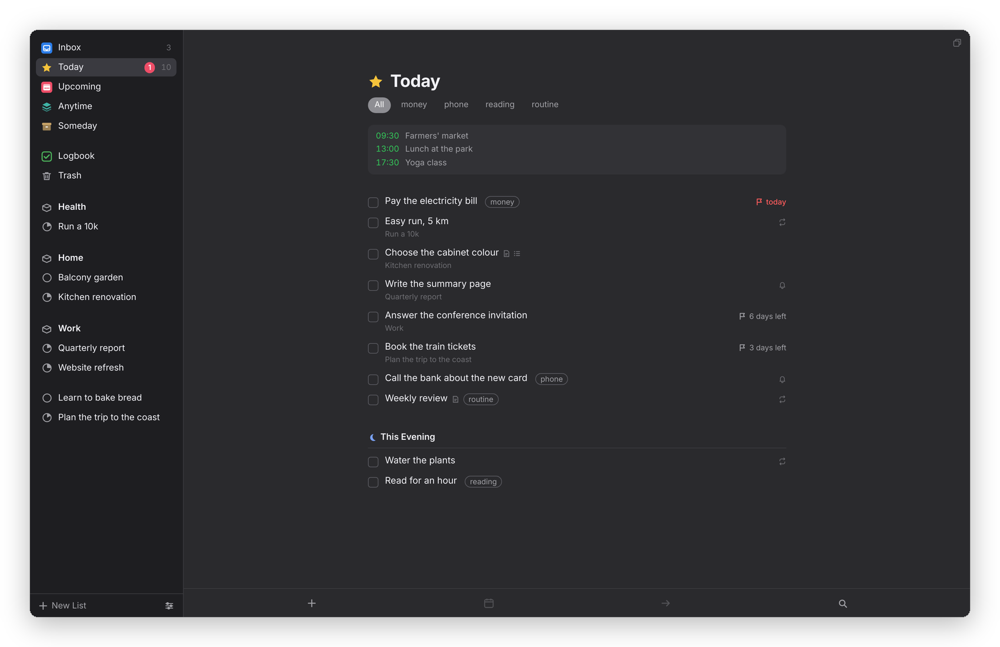

[Dvarim docs](README.md) › Devices & sync

# The Mac app

The Mac app is Dvarim in its own window, plus the things a web page can't do on a Mac: Quick Entry from any app, Today in the menu bar, a badge on the Dock, real notifications, and Shortcuts. The window shows the same web app as the browser does, carried inside the app, so every list and every key works the same. To build and install it, see [Install](install.md#3-the-mac-app).

*The Mac app's window is the web app, and follows the Mac into dark mode.*

## Quick Entry

Press ⌃Space in any app and a small panel opens over what you're doing, with a line for the to-do and room for notes under it. Type it the way you'd say it, "Call the bank tomorrow 11am #phone !fri", press Return, and it's saved to the Inbox, or to Today or Upcoming if you gave it a date. The panel closes and you're back where you were, without Dvarim ever coming to the front. Escape closes it without saving.

You can choose another key in **Dvarim → Settings…**: click the shortcut and press the one you want. It has to use ⌃, ⌥ or ⌘. Other apps may want ⌃Space too, macOS itself among them (for switching keyboard languages), and Settings tells you when your choice clashes with one of them. **File → Quick Entry** always works.

## Today in the menu bar and on the Dock

With **Show Today in the menu bar** on, today's count sits beside the clock, and clicking it shows the list, where you can tick a to-do off without opening a window. The Dock icon shows a badge too, counting whatever Settings → General → **Badge count** says in the web app: Today, the Inbox, or nothing.

## Reminders

A to-do's reminder arrives as a Mac notification, with a **Complete** button, and clicking the notification opens that to-do. **Notify me here when a reminder is due** in Dvarim → Settings… turns this off, for instance if the server already sends you reminders over Signal. The app has to live in `/Applications` for macOS to let it ask for notifications at all, and if you once said no, you turn it back on in System Settings → Notifications → Dvarim.

## Windows and menus

⌃⌘N opens a new window, and the button at the top right of any list opens that list in a window of its own. ⌘N is left to the web app, where it means New To-Do. The **Go** and **To-Do** menus list the shortcuts where a Mac expects to find them, **View → Show or Hide Sidebar** (⌘/) gives you a narrow window with just the list, and ⌃⌘R reloads. A link in a to-do's notes opens in your browser, and **Open Dvarim at login** starts it with the Mac, so the menu bar, the badge, Quick Entry and reminders are there without you doing anything.

## From other apps

Select some text in any app and choose **New To-Do in Dvarim** from the app's Services menu: Quick Entry opens with the first line as the title and the rest as notes. You can give it a key of its own in System Settings → Keyboard → Keyboard Shortcuts → Services.

Shortcuts, Spotlight and Siri know three actions: **Create To-Do** (with a list to put it in, the Inbox unless you say otherwise), **Show Quick Entry** and **Open List**. These need the app to be built on a Mac with Xcode installed, and launched once, before Shortcuts lists them.

## Where your to-dos live

**Dvarim → Settings…** has three choices under "Where your to-dos live", and the first is the default:

- **On this Mac, synced with the server.** The app keeps a copy of your to-dos on the Mac, in a folder of its own, and syncs it with the server a moment after each change, when the window comes to the front, and every few minutes. Sign in once in a Dvarim window and it sets itself up: it adds this Mac to the server's devices (you'll see it, named after the Mac, in the web app's Settings → Sync) and keeps that device's token in the Keychain. From then on the window opens with no network, and the menu bar, the badge, Quick Entry and reminders all read the copy. **Sign out** in Settings → Account sends what's left, takes the Mac off the server's list, and moves the copy to the Trash.
- **On the server only.** The window opens the server, the way a browser does.
- **In a folder on this Mac.** A folder you choose, with no server at all (below).

## Without a connection

With the copy, there's nothing to wait for: the whole app works on the Mac, and what you do reaches the server when it's back. On the server only, a Quick Entry line, a Create To-Do from Shortcuts, a tick in the menu bar and a reminder's **Complete** are kept on the Mac and sent when the server answers again. Quick Entry says how many are waiting, and the badge and the menu bar keep showing what they last knew. Inside the window, the web app keeps its own copy of each list and its own queue of edits.

## A folder instead of a server

In **Dvarim → Settings…**, under "Where your to-dos live", choose **In a folder on this Mac** and pick a folder, like the Tasks folder of your Obsidian vault. The app then carries the web app inside it and reads and writes that folder itself, with no server at all, and when Obsidian, Syncthing or iCloud Drive changes a file, it's on screen a moment later. The menu bar, the badge, Quick Entry and reminders all work on the folder too. If nothing else syncs that folder, the web app's Settings → Sync can keep it in step with a Dvarim server or any WebDAV server (see [Sync](syncing.md)), and Settings → Calendar can show this Mac's own calendars (see [Calendars](calendars.md)).

## Signing in

On a server with a password, sign in once, in the Dvarim window, on the web app's own sign-in screen. The menu bar, the badge, reminders and Quick Entry use that same sign-in, so there's only ever one password, and the app itself never sees it. With the copy, the app turns that sign-in into a device token of its own, which is what it syncs with from then on.

The build notes, signing, and the self-test that drives the built app are in [the Mac build notes](https://github.com/franz-rosenzweig/dvarim/blob/master/mac/README.md).

Next: [The Android app](android.md) →
