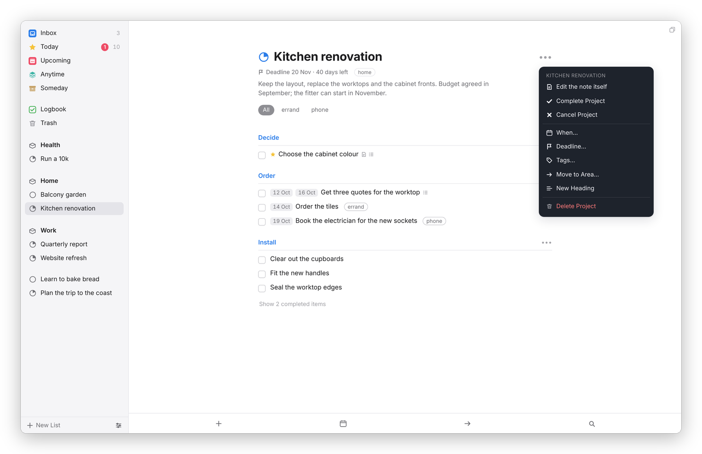
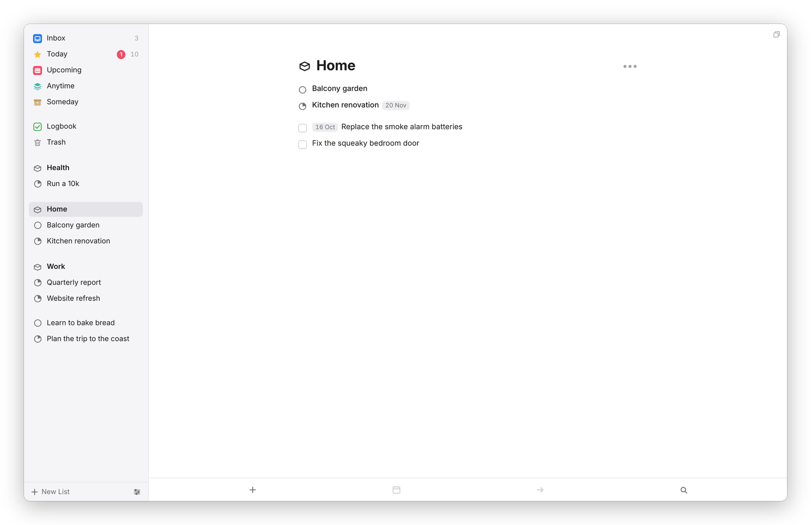

[Dvarim docs](README.md) › Using Dvarim

# Areas, projects and headings

Areas and projects are how Dvarim holds anything bigger than a single to-do. An "area" is a part of your life that never ends, like Home, Work or Health. A "project" is something that does end, like a kitchen renovation or a trip, and it can sit inside an area or on its own. Inside a project, "headings" break a long list into stages. In your files, an area is a folder, a project is a Markdown file, and a heading is a `##` line in that file.

## Making them

**New List** at the bottom of the sidebar offers **New Project** and **New Area**. ⌥⌘N makes a new project too, inside the area you're looking at. A new project opens with its name ready to type, and so does a new area.

If a to-do turns out to have more than one step, you don't have to start over: select it and press ⇧⌘P, or right-click it and choose **Convert to Project**. The to-do's title becomes the project's name, its notes become the project's notes, its When, deadline and tags come along, and each checklist item becomes a to-do of its own. The new project lands in the same area the to-do was in.

## A project

*A project with three headings. Its pie fills as to-dos are done, and its deadline counts down under the name.*

At the top of a project are its name, its deadline and tags if it has them, and its notes, which you can click and type into like any note. Below that come its to-dos, the loose ones first and then each heading with its own. The pie beside the name, and in the sidebar, is how much of the project is done. Completed to-dos leave the list, and **Show N completed items** at the bottom brings them back into view.

The ••• button at the top right is the project's menu:

*Everything you can do to a project, in one menu.*

- **Edit the note itself** opens the project's actual Markdown file inside the app. See [Your to-dos as Markdown](files.md).
- **Complete Project** marks it done. If some of its to-dos are still open, Dvarim asks first: **Complete them too**, or **Leave them open**.
- **Cancel Project** marks it canceled. Either way it moves to the Logbook, and the file stays where it is.
- **When…** and **Deadline…** work as they do for a to-do. A project whose When arrives shows up at the top of Today, and one in Someday is listed in the Someday list.
- **Tags…** tags the whole project.
- **Move to Area…** moves it into another area, or to **No Area**.
- **New Heading** adds a heading, named and ready for you to type over, and so does ⇧⌘N.
- **Delete Project** asks, then moves the project and its to-dos to the Trash, where you can restore it until you empty it.

If you've told the server where your Obsidian vault is, there's an **Open in Obsidian** item at the top as well.

## Headings

A heading groups the to-dos under it, and its own ••• menu, at the right of the heading's line, has **New To-Do** (which adds one under that heading), **Rename**, **Archive Heading** and **Delete Heading**. Archiving is for a stage that's finished: it completes the open to-dos under the heading and files the heading away with them, and **Unarchive Heading** brings it back. Deleting a heading keeps its to-dos in the project.

On a phone, you can make a heading with the green plus: hold it, carry it to the left margin of the project where you want the heading, and let go when the line says NEW HEADING.

## An area

An area's page lists its projects first and then the to-dos that belong to the area itself, outside any project. Its ••• menu has **Edit the note itself**, **New Project**, **New To-Do**, **Tags…** and **Delete Area**. Deleting an area keeps everything that was in it: its projects move out to stand on their own, and its loose to-dos move to Anytime.

*An area holds projects and loose to-dos. Its notes and tags live in a note of its own, inside its folder.*

## Moving things around

Drag a to-do onto a project or area in the sidebar to move it there, or select it and press ⇧⌘M for the Move popover, where you can type to find a project, an area or a heading.

Next: [To-dos](todos.md) →
