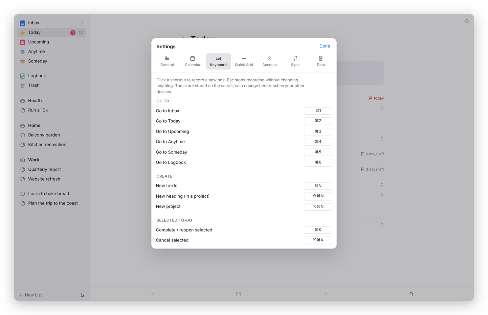

<sub>[Dvarim docs](README.md) › Using Dvarim</sub>

# Quick entry and keyboard shortcuts

This page is the reference for getting things into Dvarim quickly, from inside the app and from outside it, and for every keyboard shortcut. The rule behind all of it is that writing a thought down should take one line and no decisions. Whatever has no date goes to the Inbox, and you sort it out later.

## From inside the app

Press ⌘N, or the **+** at the bottom of the window, and type. On a phone, tap the blue plus, or hold it and carry it to where the to-do should go. [To-dos](todos.md) has the details.

## The quick-entry line

Everywhere outside the app, you type one line, and Dvarim reads it like this:

| You type | What it does |
| --- | --- |
| `Call the plumber` | a to-do in the Inbox |
| `… tomorrow`, `… friday`, `… in 3 days`, `… oct 2` | a date phrase at the end sets When |
| `… tomorrow 3pm` | When, and a reminder at 15:00 |
| `… tonight` | This Evening |
| `… someday` | Someday |
| `!friday`, `!oct 30` | the deadline |
| `@9am`, `@15:30` | a reminder (on today, if there's no other date) |
| `#home` | a tag, anywhere in the line |

So "Call the plumber tomorrow 3pm #home !fri" becomes "Call the plumber", in Today tomorrow with a reminder at three, tagged home, due on Friday. A to-do with a date goes straight to Today or Upcoming, and one without goes to the Inbox. Anything the parser isn't sure about stays in the title, so it never eats your words.

## On the Mac: Quick Entry

Press ⌃Space in any app and a small panel opens over whatever you're doing: a line for the title, with room for notes underneath. Type, press Return, and it's saved and the panel is gone, without Dvarim ever coming to the front. Escape closes it without saving, and ⌥Return starts a new line in the notes. If the server can't be reached, the Mac keeps the line and sends it later, and the panel says how many are waiting.

You can record a different key in **Dvarim → Settings…**, which is worth doing if macOS already uses ⌃Space for switching keyboard languages. There's also **File → Quick Entry**, a **New To-Do in Dvarim** item in the Services menu of every app (the selected text becomes the to-do), and a **Create To-Do** action in Shortcuts, Spotlight and Siri. See [The Mac app](mac.md).

## On Android: sharing, and New To-Do

Share anything into Dvarim from another app, a link, a page or some text, and a sheet called **Add to Dvarim** opens with the title filled in. Fix the wording, add a date the same way ("tomorrow 3pm", "!friday", "#tag"), and press **Add**. **New To-Do** on the icon's long-press menu, or the quick-settings tile, opens the Inbox with an empty to-do ready to type. See [The Android app](android.md).

## From anywhere else: Quick Add

Anything that can send an HTTP request can add a to-do: a bot, a Shortcut on a phone, a bookmarklet, a cron job. Settings → **Quick Add** shows the exact command for your server, with a button to copy the address:

```bash
curl -X POST https://your-server/api/quick-add \
  -H 'content-type: application/json' \
  -H "Authorization: Bearer $DVARIM_TOKEN" \
  -d '{"text": "Call the plumber tomorrow 3pm #home !fri"}'
```

When the server has a password, a bot needs a token of its own, which you make with `node server/src/cli.js add-token my-bot` on the server (see [Your own server](server.md)). This is how my Signal bot adds to-dos.

## Keyboard shortcuts

These are the defaults. On Windows and Linux, ⌘ is Ctrl. Every one of them can be changed in Settings → **Keyboard**: click a shortcut and press the new keys, **Clear** leaves an action without a key, and **Default** puts the original back. A change there reaches your other devices too.


*Settings → Keyboard.*

| Keys | What it does |
| --- | --- |
| ⌘1 to ⌘6 | Go to Inbox, Today, Upcoming, Anytime, Someday, Logbook |
| ⌘F or ⇧⌘F | Quick Find |
| any letter | Quick Find, with that letter already typed |
| ⌘, | Settings |
| ⌘/ | Show or hide the sidebar |
| ⌘N | New to-do, in the current list or heading |
| ⇧⌘N | New heading (in a project or Today) |
| ⌥⌘N | New project |
| ↩ or Space | Open the selected to-do |
| Esc | Close a popover, then the to-do, then clear the selection |
| ↑ ↓ | Select the previous or next to-do (with ⇧, extend the selection) |
| ⌘A | Select every to-do in the list |
| ⌘↑ ⌘↓ | Move the selected to-do up or down |
| ⌘K | Complete, or reopen |
| ⌥⌘K | Cancel |
| ⌘S | When… |
| ⌘T | Today |
| ⌘E | This Evening |
| ⌘R | Anytime (clear the When date) |
| ⌘O | Someday |
| ⇧⌘D | Deadline… |
| ⇧⌘R | Repeat… |
| ⇧⌘M | Move… |
| ⇧⌘T | Tags… |
| ⇧⌘C | Add or go to the checklist |
| ⇧⌘P | Convert to project |
| ⌘D | Duplicate |
| ⌫ or Delete | Move to Trash |
| ⇧⌘Y | Log completed items |
| ⌘Z | Undo |

In the Mac app, three more belong to the app itself: ⌃Space for Quick Entry, ⌃⌘N for a new window, and ⌃⌘R to reload.

While you're writing notes: ⌘B bold, ⌘I italic, ⇧⌘U highlight, ⌥⌘U strike through, ⇧⌘J code, ⇧⌘K link, ⇧⌘L bulleted list, ⌥⌘L numbered list, ⌘' quote, and ⌘] and ⌘[ to indent. In the title, Return closes the to-do. In a checklist, Return adds the next item and ⌘↑ ⌘↓ move the current one.

In a normal browser tab, the browser keeps ⌘N (Ctrl+N) for itself. It works in the installed app, or you can give New To-Do another key.

<sub>Next: [Quick Find](search.md) →</sub>
