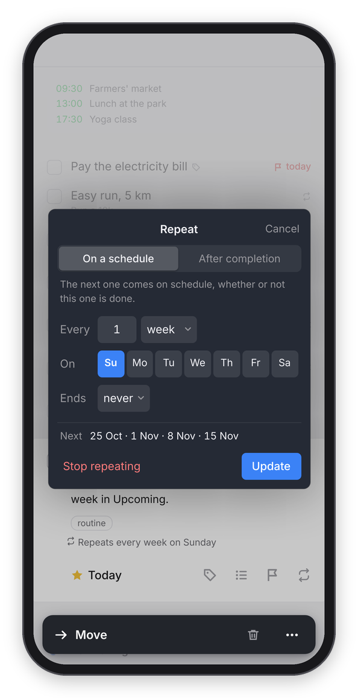

<sub>[Dvarim docs](README.md) › Using Dvarim</sub>

# Repeating to-dos

A repeating to-do comes back by itself: you tick it off, and the next one is already there with its new date. This page is about setting one up and what happens when you complete it. Dvarim offers two kinds: "On a schedule", like every Sunday, whether or not you did the last one, and "After completion", like every three days counted from the day you last did it.

## Setting a repeat

Select a to-do and press ⇧⌘R, or click the repeat button at the bottom right of its card, or right-click it and choose **Repeat…**.

<p align="center"></p>

*The Repeat editor, here on a phone. The line at the bottom shows the next four dates.*

1. Choose **On a schedule** or **After completion** at the top. The line under it says in plain words what the choice means.
2. After **Every**, set the number and the unit: days, weeks, months or years.
3. For weeks, pick the days after **On** with the two-letter buttons, for example **Mo** and **Th**. They run in the order of your own week, the way Settings → General → **Week starts on** has it. For months, **On** reads like a sentence, "the [15th] [day]" or "the [2nd] [Tuesday]": pick which one in the first menu ("last" is there too) and "day" or a weekday in the second. For years, pick the month and the day.
4. **Ends** can be **never**, **on** a date, which starts a year out, or **after** a number of times.
5. Check the **Next** line, which shows the next four dates worked out by the same rules the app uses, then press **Repeat** (or **Update**, for a to-do that already repeats). Return in any of the fields does the same.

If a rule can never happen, like every year on the 30th of February, the **Next** line says "That never happens" instead of dates.

An open repeating to-do shows the repeat icon on its row, and its card says the rule in words, like "Repeats every week on Sunday". Click that line to change the rule.

## What happens when you complete it

When you tick off a repeating to-do, Dvarim marks that line done and puts a fresh copy above it, with the next When date, and the deadline moved on by the same distance if it had one. The copy keeps the title, notes, tags, This Evening and the reminder time, and its checklist comes back with every item unticked.

With **On a schedule**, the next date is the next one in the schedule after the one you just did, even if that's already past. So if you skipped a week, the missed one comes up in Today rather than quietly disappearing. With **After completion**, the next date is counted from the day you ticked it off.

## Changing or stopping it

To move just this one, change its When date the normal way: the rule stays the same, and the next copy follows the rule. To change the rule, open the Repeat editor and press **Update**. To stop it repeating, open the editor and press **Stop repeating**, and it becomes an ordinary to-do.

## The rule lives on the to-do

The open to-do itself carries the rule, which is what the Obsidian Tasks plugin does too, so there's nothing hidden and nothing to get out of step. Two things follow from that. There's no **Pause**, and to set a deadline a few days after the start, you give the to-do both a When and a deadline, and both move on together.

## In the file

The rule is written after a `🔁` on the to-do's line, in the Obsidian Tasks plugin's own words, so Obsidian understands it:

```
- [ ] Weekly review #routine 🆔 k3j9a2xq 🔁 every week on Sunday ⏳ 2026-10-11
- [ ] Water the plants 🌙 🆔 p4m8r1zt 🔁 every 3 days when done ⏳ 2026-10-11
- [ ] Pay the rent 🆔 w2c7n5ha 🔁 every month on the 1st until 2027-06-30 ⏳ 2026-11-01
```

`when done` means After completion. Dvarim adds two endings the plugin doesn't have, `until` a date and `for 12 times`.

<sub>Next: [Quick entry and keyboard shortcuts](quick-entry.md) →</sub>
