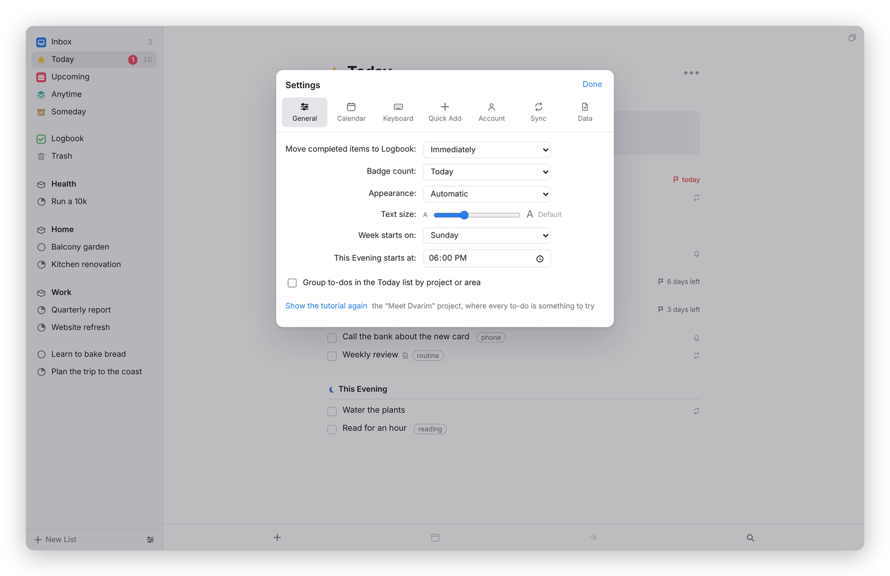
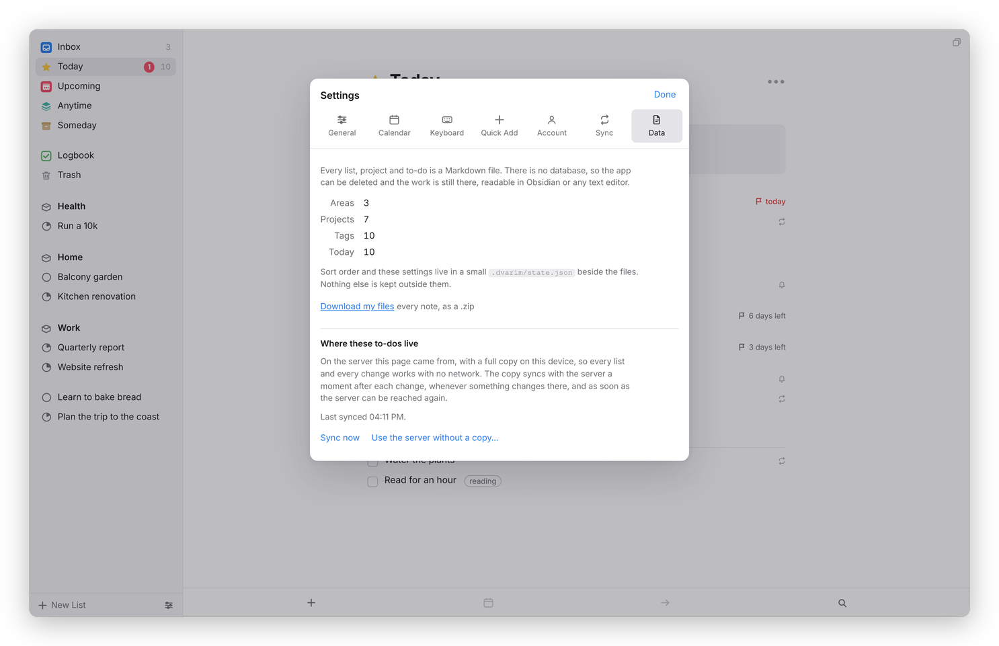

[Dvarim docs](README.md) › Using Dvarim

# Settings

This page goes through Settings pane by pane. Open it with ⌘, (comma), the sliders button at the bottom of the sidebar, or by typing "settings" in Quick Find, and close it with **Done**. Most settings are kept on the server, in the same `.dvarim/state.json` as your sort orders, so they follow you to every device. The two exceptions are Appearance and Text size, which belong to the device you're on.

## General

*Settings → General.*

- **Move completed items to Logbook**: **Immediately**, **Daily** (completed to-dos stay in their list, ticked, until the day turns) or **Manually** (they stay until you press **Log Now** in the Logbook, or ⇧⌘Y).
- **Badge count**: what the number on the Mac app's Dock icon counts: **Today**, **Inbox** or **None**.
- **Appearance**: **Automatic** follows your device's light or dark mode, or choose **Light** or **Dark**.
- **Text size**: a slider from 85% to 130%, and **Default** puts it back.
- **Week starts on**: the first day of the week, for the calendars and for "next week".
- **This Evening starts at**: a time that's saved with your settings, though nothing in the app uses it yet.
- **Group to-dos in the Today list by project or area**: Today shows the loose to-dos first, then a heading for each project and area.
- **Show the tutorial again**: opens "Meet Dvarim", the project every new vault starts with, where every to-do is something to try. If you've finished or deleted it, you get a fresh one.

### Offline

Dvarim keeps a full copy of your to-dos on each device you use it on, so every
list and every change works with no network, even lists you haven't opened
there before. When the network comes back, it catches up by itself, usually
within a few seconds. Settings → Data says when it last synced and has a Sync
now button. Signing out takes the copy off the device.

## Calendar

**Show calendar events in Today and Upcoming lists** turns the events on or off. Under it, each calendar has a checkbox with its colour, and **All** and **None** tick or untick them together. In the Mac and Android apps working on a folder, **Show this device's calendars** shows the device's own calendars instead, and the device asks you for permission once. Below that, "Your to-dos in other apps" says whether the server mirrors your to-dos to a CalDAV task list, when it last ran, and has a **Sync now** button. [Calendars](calendars.md) explains both.

## Keyboard

Every action with its shortcut. Click a shortcut and press the keys you want, **Clear** leaves the action without a key, and **Default** puts the original back. If the keys are already used by something else, it tells you and offers to move them. The list is in [Quick entry and keyboard shortcuts](quick-entry.md#keyboard-shortcuts).

## Quick Add

The command any program can use to add a to-do to your Inbox, with **Copy the endpoint**, and a short guide to the date words it understands. See [Quick entry and keyboard shortcuts](quick-entry.md#from-anywhere-else-quick-add).

## Account

Change your password here: type the current one and the new one twice, at least 8 characters, and press **Change password**. Changing it signs out your other devices, and this one stays signed in. **Sign out** ends this browser's session only, and where the device keeps a copy of your to-dos, it sends what's left to the server first and then takes the copy off the device. If the server has no password at all, this pane says so and gives the command that sets one.

If you run the server, **People** is here too, under the password: your own sign-in name, anyone who has asked for an account (**Invite** or **Dismiss**), the people already on your server (**New password…** and **Remove**), invitations nobody has used yet, and **Make an invitation link**. Someone who signs in with a name of their own sees "Signed in as" and their name at the top, and no People. [Other people on your server](PEOPLE.md) goes through all of it.

## Sync

On the server, Sync is where you let other devices keep their own copy: give each one a name and press **Add a device**, and you get a token for it, shown once. **Remove** stops that device at once. On a device that keeps its own copy, the same pane is where you connect it: **Off**, **A Dvarim server** (the address and the token) or **A WebDAV server: Nextcloud, Synology, and others**, then **Save and sync**. In the Mac and Android apps, which keep a copy of their own, the pane only says which server the app syncs with, because the app set it up, and has **Sync now**. [Sync](syncing.md) goes through it step by step.

## Data

*Settings → Data.*

Data says what's in your files: how many areas, projects and tags, and how many to-dos are in Today. In a browser, **Download my files** gives you every note as a .zip. Under "Where these to-dos live" it says where the files are. On the web, that's the server, with a full copy on this device: it says when the copy last synced, with **Sync now**, and **Use the server without a copy…** goes back to the old way, where only the lists you've opened are kept for when there's no network. From there, **Keep a full copy on this device, so it all works offline** turns the copy back on, and **Keep a vault in this browser instead…** is an experimental mode where the browser keeps its own vault with no server at all, which starts empty and lives in the browser's storage. In the Mac and Android apps working on a folder, it names the folder and has **Choose another folder…**, **Use a server instead…** and **Check this folder**, which runs the same checks every app must pass on its storage, so you can see that a folder works properly before you trust it with your to-dos. It also lists any files that were changed on two devices at once and merged, and on Android and the Mac there's a link to the app's own settings.

Next: [Your to-dos as Markdown](files.md) →
