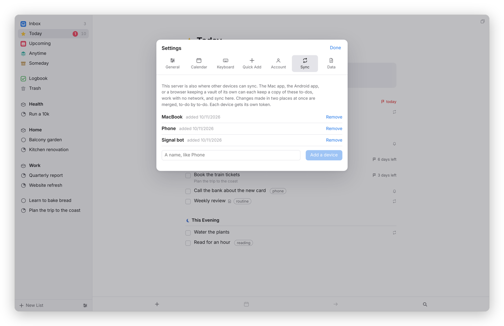

[Dvarim docs](README.md) › Devices & sync

# Sync

This page is about keeping your to-dos the same on every device. Dvarim reads and writes a folder of Markdown and, like Obsidian, doesn't much care what moves that folder around. There are three ways to set it up, and you can mix them, one per device.

## Three ways

**1. Every device uses the server.** This is the simplest: the files live in one place, on the server, and the web app, the Mac app and the Android app all sign in to it. Each of them keeps a full copy of your to-dos on the device and syncs it with the server by itself, a moment after each change and whenever you come back to it, and there's nothing to set up. So it all works on a plane, every list included, and what you do there reaches the server when it's back online. If you'd rather a device kept no copy, Settings → Data in the browser and **On the server only** in the apps' own settings switch it off, and then only the lists you've opened are kept.

**2. A folder that something else keeps in step.** The Mac and Android apps can work on a folder on the device ("In a folder on this Mac", "In a folder on this phone"), with no server at all. Syncthing, iCloud Drive, Dropbox or Obsidian Sync then moves the folder between devices, exactly as they would your notes. This is how the vault reaches my Mac and phone.

**3. The built-in sync.** This is what the copies in way 1 use underneath, and you can also set it up yourself: a device that keeps its own folder, or a browser that keeps its own vault, can sync by itself with a Dvarim server, or with any WebDAV server, like Nextcloud or Synology. This is the dependable choice on Android, where third-party folder syncing is awkward.

## When two devices changed the same file

Every to-do carries its own id, so when two versions of a file meet, Dvarim compares them to-do by to-do and field by field, against the version both started from, instead of keeping one file and throwing the other away. In plain words:

- **Nothing you did is lost.** If two devices changed different to-dos, both changes are kept, and the same if they changed different things about one to-do (one ticked it, the other moved its date).
- **When both changed the same thing**, one change wins, and it's the same one on every device. Done beats canceled, and canceled beats open. A date set on one side beats a date cleared on the other, and between two dates the later one wins. Between two titles, the one further along wins. Two versions of the notes are both kept, one after the other. Tags and checklist items are merged.
- **Deleted on one device and changed on the other**: it's kept, with the change.
- **A sync tool's conflict copy** (Syncthing's `.sync-conflict-` files, Dropbox's and Nextcloud's "conflicted copy") is merged back into the real file and moved to `.dvarim/conflicts/`, never deleted. Settings → Data lists the files that were merged since the app opened.
- **An edit made in Obsidian wins**, even one that undoes something the app did.
- **Settings and sort orders**: the newest change wins, setting by setting.

The rules, and the tests that prove them, are in [Sync you can trust](SYNC.md).

## Setting up the built-in sync

On the server, open Settings → **Sync**, type a name for the device, like "Phone", and press **Add a device**. You get the server's address and a token for that device, shown once, so copy it now.

*On the server: one token per device. Remove one and that device stops syncing at once.*

On the device, open Settings → **Sync**, choose **A Dvarim server**, enter the address and the token, and press **Save and sync**.

*On the device. The first sync brings everything down, and the line under the button says what each round did.*

For any other WebDAV server, choose **A WebDAV server: Nextcloud, Synology, and others**, and give it the folder's address, a user name and a password (an app password, if the server offers them). The address and the token or password stay on the device, never in the files.

From then on it syncs when the app opens, when its window comes back to the front, a few seconds after you change something, and every five minutes while it's in front. **Sync now** runs a round straight away. It syncs your notes, `state.json` and `stamps.json`, and nothing else in the folder, so your Obsidian settings and attachments stay where they are.

Two things to know. Use one sync per folder: a folder that syncs this way shouldn't also be synced by Syncthing or iCloud Drive, because the record of what was agreed would travel with it and mislead the other devices. And in a browser, most WebDAV servers other than Dvarim's own (Nextcloud included) refuse requests from another site, so for those, sync from the Mac or Android app, which make the requests themselves.

## If you sync the server's folder

When the server's own folder is synced by a tool that leaves conflict copies, like Syncthing, nothing needs setting up. If it's synced by something that keeps only the newer of two files and leaves no copy, set `DVARIM_MERGE_ARRIVALS=1` on the server, so it merges what arrives instead of taking it as it is (see [Your own server](server.md)). The price is that undoing one of the app's changes in Obsidian doesn't stick in that mode.

## What it doesn't do yet

A to-do moved to another file on one device and edited on the other can end up in both files. Nothing is lost, and you delete the extra copy by hand.

Next: [Calendars](calendars.md) →
