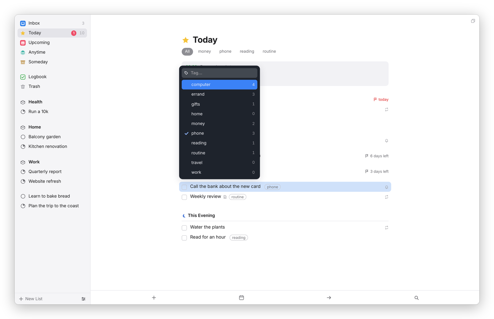
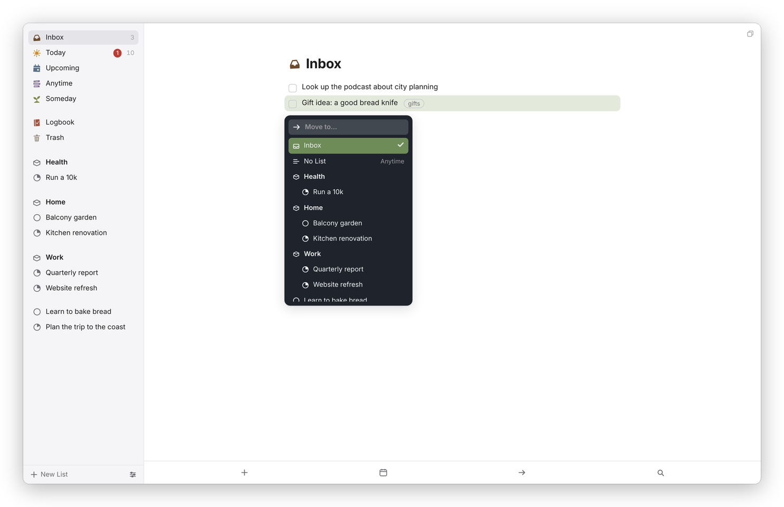

[Dvarim docs](README.md) › Using Dvarim

# To-dos

A to-do in Dvarim is one line in a Markdown file, and in the app it's a row you can open into a card. This page is about the card and everything you can do to a to-do. Dates have [their own page](dates.md), and so do [repeats](repeats.md).

## Making a to-do

Press ⌘N, or the **+** at the bottom of the window, and a new to-do opens in the list you're looking at, below whatever you'd selected, with its title ready to type. In a project it goes under the heading you're in. Type the title and press Return, and the card closes.

On a phone, the green plus at the bottom right does the same with a tap. You can also hold it and carry it: let go between two to-dos and the new one goes exactly there, or carry it to the Inbox target at the bottom left to drop a to-do in the Inbox without leaving the list you're reading.

For getting things in from outside the app (the Mac's ⌃Space, sharing on Android, a bot), see [Quick entry and keyboard shortcuts](quick-entry.md).

## Opening the card

Double-click a to-do to open it, or select it and press Return. Clicking a to-do that's already selected opens it too. Esc closes the card, and so does clicking outside it. Everything you type is saved as you go.

*A to-do's notes are Markdown, shown the way Obsidian's live preview shows it.*

## Notes

Under the title is "Notes", which takes any Markdown. It's shown formatted while you read it, and wherever the cursor is you see the real text, the way Obsidian's live preview works: headings, **bold**, *italic*, ==highlight==, ~~strike~~, code, quotes, bulleted and numbered lists, task lists with boxes you can tick, and links, which open with a click while you're reading and with ⌘-click while you're writing. Return carries a list on to the next line. The shortcuts are ⌘B, ⌘I, ⇧⌘U for a highlight, ⌥⌘U to strike through, ⇧⌘J for code, ⇧⌘K for a link, ⇧⌘L for a bulleted list, ⌥⌘L for a numbered one, and ⌘] and ⌘[ to indent. Highlights are written Obsidian's way, with `==`.

## Checklists

A checklist breaks one to-do into small steps without making it a project. Press the checklist button at the bottom of the card, or ⇧⌘C, and type the first item. Return makes the next one, Backspace on an empty item removes it, ⌘↑ and ⌘↓ move an item, and you can drag one by its grip on the right. Tick an item with its circle. If you paste a list into a checklist item, every line becomes its own item and the bullets are taken off, so a list copied from an email or a note goes straight in.

## Tags

Tags are for cutting a long list down, like #errand, #phone or #computer. Press the tag button at the bottom of the card, or ⇧⌘T, and pick from your tags or type a new one. A tag can be nested, like `home/garden`. Today, Upcoming, Anytime and each project then show their tags as a row under the title, and clicking one filters the list.

*The tag picker. A tag only some of the selected to-dos have shows a dash.*

In the file, a tag is just `#tag` in the to-do's line, which is how Obsidian reads tags too.

## Completing, canceling and deleting

Click the box to complete a to-do, or press ⌘K. To cancel it instead, which keeps the record that you decided not to do it, press ⌥⌘K or right-click it and choose **Mark as Canceled**. Both go to the [Logbook](lists.md#logbook), and clicking the box of a completed to-do reopens it.

⌫ or Delete moves the selected to-do to the Trash. ⌘Z undoes the last complete, cancel, delete, move or date change, and a small note at the bottom says what was undone.

## The right-click menu

Right-click any to-do for **When…**, **Move…**, **Tags…**, **Deadline…**, **Repeat…**, **Complete**, **Mark as Canceled**, **Duplicate** (⌘D), **Convert to Project** (⇧⌘P) and **Delete**. On a phone, the same things are in the dark bar under an open to-do: **Move**, the bin, and ••• for the rest.

## Moving

Press ⇧⌘M, or choose **Move…**, and type to find where it should go: the Inbox, **No List**, an area, a project or a heading inside a project. You can also drag a to-do onto a project, an area or a list in the sidebar, or drag it up and down within a list.

*Move. "No List" means no area and no project, which puts it in Anytime.*

## Many at once

⌘-click adds a to-do to the selection, Shift-click takes everything in between, ⌘A takes the whole list, and Shift with ↑ or ↓ extends the selection. Then any key above works on all of them, and so does the right-click menu. On a phone, swipe a to-do to the left to start choosing, tap the others, and the bar at the bottom has **When**, **Move**, **Tags** and **Delete**.

## Open in Obsidian

If your server knows where your vault is (see [Using it with Obsidian](obsidian.md)), the card has an Obsidian button at the bottom right that opens the to-do's own line in Obsidian.

Next: [When, deadlines and reminders](dates.md) →
